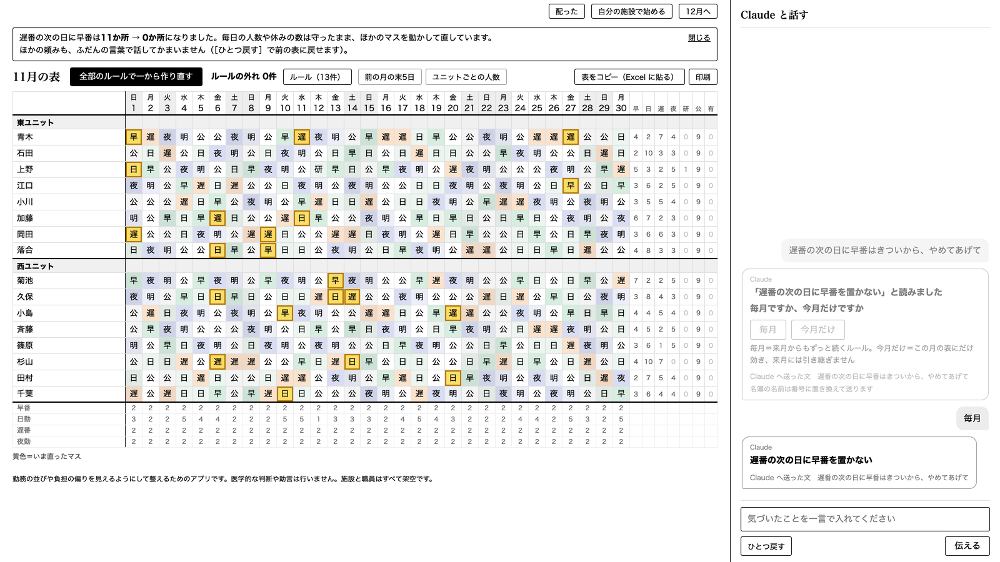
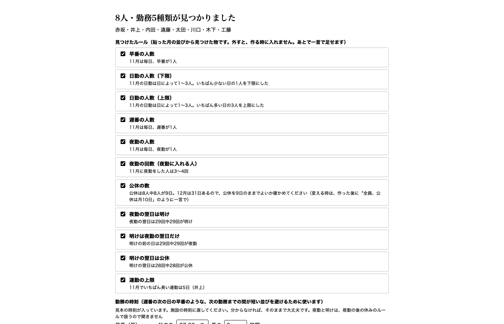
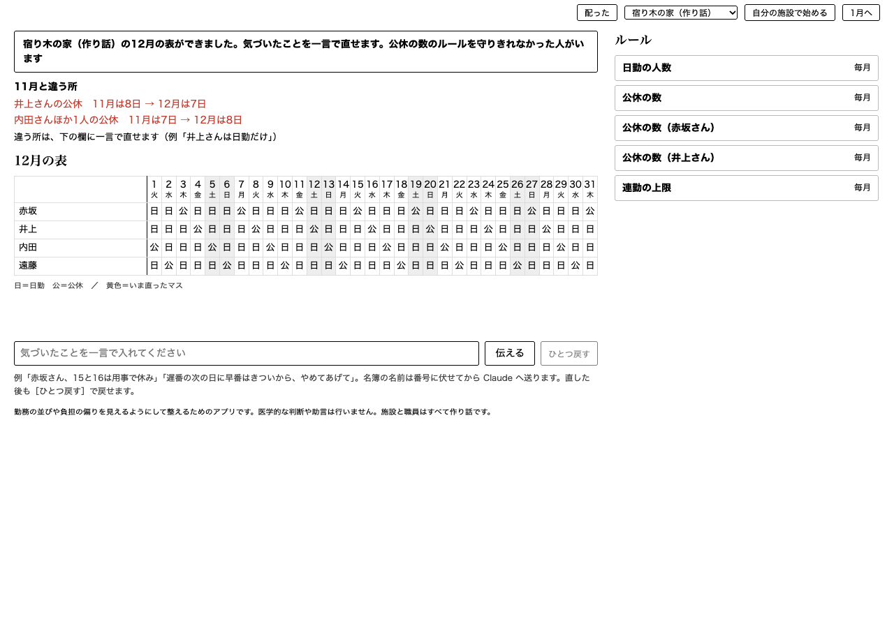

# KaigoShiftVoice

シフトで働く人（介護員）の負担を、勤務表から軽くするアプリです。表は話した言葉で直せます（Built with Claude: Japan 2026 の作品）。

早寝早起きや週末の休みのような健康法の多くは、9時5時で働く人向けです。いつ働くかを選べない介護員は、次の勤務までの休みも、穴埋めの偏りも、勤務表で決まります。人が組むと、職員が多いほど、そこまでは徹底しきれません。

シフトがうまく組めると、働く人の心に余裕が生まれます。その余裕は介護や福祉の現場で働く人の心と体を守り、日本中のケアの質を底上げする土台になると考えています。良いケアは余裕だけでは成り立ちませんが、余裕がなければ始まりません。

- 勤務の並びや負担の偏りを見えるようにして整えるためのアプリです。医学的な判断や助言は行いません
- デモの施設「ひだまりの郷」と職員は、すべて架空です

## すぐ試す（3行）

1. Mac は、このフォルダの `はじめる.command` をダブルクリック（はじめては右クリック →［開く］）。ターミナルなら `uv run shiftvoice demo`（Windows は下の「動かし方」）
2. ブラウザに架空の施設の表が開きます。右上の［自分の施設で始める］で、自分の Excel の勤務表を貼ると来月の表ができます（ここまで Claude の鍵は要りません）
3. 下の欄に「遅番の次の日に早番はきついから、やめてあげて」のように一言打つと、表が直ります（ここは自分の Claude の鍵が要ります）



| Excel の表を貼ると、見つけたルールが出る | 作った来月を、前の月と並べて違う所を赤で出す |
|---|---|
|  |  |

## 誰の、どんな困りごとか

作者は介護施設で毎月シフトを作っています。介護員は自分の勤務を選びにくく、急な休みの電話が入ると、だれかが穴埋めを引き受けます。引き受けるのはいつも同じ人になりがちですが、その負担は表に残らず、翌月の表は何もなかったように組まれます。同僚の介護員4人以上に聞くと、遅番の次の日の早番は「論外」、急な休みの穴埋めは「施設に誰もいない時間は作れないので、引き受けざるを得ない」、引き受けた人に翌月報いる仕組みは「引き受けやすくなるというより、心理的な不公平感と負担感がなくなる」という答えでした（2026-11-04。名前は記録していません）。

どれくらい偏るかを、架空の施設「ひだまりの郷」の11月の表で試算しました（`uv run python tools/absence_sim.py`、7秒）。土日に勤務の人が1人ずつ急に休んだ全部の場合76件を、待機の仕組みが無い時の直し方で1件ずつ試すと、46件でその日休みの人に電話が要りました。電話を受けて入ったのは、小島さん9回・田村さん6回でした（電話を受けた14人の平均は約3回）。表を作る人は、この電話を休みの連絡のたびに、月に数回かけています。

ルールも施設ごとに違い、月ごとに増えます。「遅番の次の日に早番はきつい」「この人は試験までは夜勤3回まで」。用意された欄から選ぶシフトソフトでは、こうした一言を入れる場所がなく、作成者の頭の中とメモに散らばります。そして、試験が終わった後も残り続けて、表を縛ります。

## このアプリがすること

1. **一言で直す。** 「岡田さん、15と16は法事で休み」と言う（または打つ）と、表の必要なマスだけが直ります。毎月か今月だけかがあいまいな時は聞き返し、名簿にない「〇〇さん」は Claude へ送らずに聞き返します
2. **施設の仕組みを言葉で足す。** 「土日は休みの人から待機1人。急な休みの電話はその人にだけ」と言うと、表に無かった待機当番の欄ができます。休みの電話では待機の人だけが動き、本人の了承をもらって直した回数が記録に残ります。休日に入った人の公休は減らさず、その人の休みを別の日へ移します（公休移動）。移す日の候補は3つまで出し、表で変わるマスや連勤が少なく、全体の負担がいちばん軽い日を先頭におすすめします
3. **引き受けた人の翌月を、少し楽にする。** 12月の表を作る前に、期限が来たルールと先月増えたルールだけを1件ずつ見直します。そのうえで12月の表を一から作り（返さない案）、引き受けた人にだけ「有給をみんなの平均＋1日」と「いちばん長い連勤を1日短く」を足します（返す案）。ほかの人の有給・5日続く勤務・飛び石は増やしません。1か月で返しきれない分は次の月へ持ち越し、3か月でならします
4. **ルールを積もらせない。** 話すたびにルールは増え、16人の施設では200件前後になります。増えるだけだと、やがて誰も全体を把握できなくなります。そこで次のようにします（考え方は [docs/rule-cleanup.md](docs/rule-cleanup.md)）
   - 表を配ると、裏で毎月のルールを1件ずつ外して作り直し、片付けの候補を探します。候補は、何か月も続けて「無くても表が同じだった」ルール、同じことを決めている2件、今の名簿にいない人のルール、「子どもの受験があるから」のように一時的な事情で足したルール（Claude が理由の文を読み分ける）です
   - 候補は、一覧の［整理する］から開く「ルールの整理」の画面に、なぜ今見るのかを1文で添えて並べます。自動では消さず、片付けた物は一覧から戻せます
   - 同じ所を決めるルールを言い直すと、「置き換えますか、別に足しますか」と聞きます
   - ルールが15件を超えたら一覧をたたみ、表の名前を押すとその人のルールだけ開きます。マスを押すと、そのマスを決めているルールと、ほかの勤務にできない理由を3件ずつ出します
5. **自分の施設の勤務表から始める。** 今使っている Excel の勤務表をコピーして貼ると、職員・勤務の種類・ルール（1日の人数・公休の数・夜勤の後の明けと公休・連勤の上限）を表から見つけて見せます。確かめて［〇月の表を作る］を押すと、翌月の表ができます。作る時は、次の勤務までの間が短い並び（14時間未満。遅番の翌日の早番など）を避け、貼った月と作った月の数を並べて見せます。人が手で組むと、職員が多いほど徹底しにくい所です。ここまで Claude の鍵は要りません
6. **作った表を持ち出す。** 表の下の小さなリンク［表をコピー（Excel に貼る）］で、開いている月の表（日付・曜日・名前・各日の記号。待機当番の欄は最後の行）をクリップボードへ入れ、施設の Excel の左上のマスに貼り戻せます。［印刷］は表と題と凡例だけを A4 横に収めます

## 要点（期間中に測った数）

- 人が組んだ表の「次の勤務までの間が短い並び」（遅番の次の日の早番など、14時間未満）を、翌月の表で避けます。見本の施設B（架空）は22回→0回、厚生労働省の標準様式の記載例3つ（国が作った見本の表）は62回→0回
- 一言の読み取り（Claude Haiku 5.5）は、撮影と試験の一言36件を3周108回すべて正しい型にできました（直す前は36件中16件。11-04 夜の版でも42件すべて同じ）
- 待機当番のような表に無い仕組みを、言葉から Claude Sonnet 5.5 が組み立てます（10回とも同じ定義。入浴係・送迎も10回中10回。表せない「第2水曜」は10回とも作らずに聞き返す）
- 11月に急な休みを引き受けた3人に、12月は有給を0→1日、いちばん長い連勤を5→4日にして返します（ほかの人の有給と連勤は増やさない）

## 期間中に測った数字（ひだまりの郷）

| 場面 | 結果 |
|---|---|
| 11月の表を作る | 動かせない決まりの外れ0件、初めての起動から約10秒 |
| 一言で直す（1幕の8件） | どれも0.4秒以内（読み取りは用意した返事） |
| 「遅番の次の日に早番はきつい」 | 当てはまり11件を、21マスを動かして直す（1.4秒） |
| 声で一言（作者が架空の台本を読んだ6本） | 名前の聞き違い0件、声を文字にするのは2本目から0.2秒前後 |
| 待機が無い時、11月の土日の急な休み76件を1件ずつ試算（`uv run python tools/absence_sim.py`） | 休みの人に電話が要った46件のうち、小島さん9回・田村さん6回（電話を受けた14人の平均は約3回）。7秒 |
| 12月を返す（11月に引き受けた3人） | 3人とも有給 0→1日、いちばん長い連勤 5→4日（1人は4→3日）。返さない案から変わるのは18マス。ほかの人の5日続く勤務（5日の窓の数）18→17・飛び石 0→0、19秒 |
| 本物の Claude Haiku 5.5 で一言を読む（撮影と試験の一言。11-04 夜は残業の穴埋めの一言を足して42件） | 36件を3周108回すべて、アプリの確かめに通した中身が用意と同じ。1回の読み取りは中央1.2秒・最長2.8秒。11-04 夜の版では42件を1周42回すべて同じ（中央1.7秒・最長3.4秒） |
| 同じく、指示文の例に使っていない別の言い方22件 | 3周66回すべて同じ（直す前は66回中64回）。11-04 夜の版でも1周22回すべて同じ |
| 台本の3幕を本物の Claude で通す（11-04 夜の版） | 14件すべて通る（Claude を156回呼ぶ、6分48秒。同じ Mac でほかの重い計算が動いていた） |
| 声から本物の Claude Haiku 5.5 を通して表が直るまで（作者の声3本×3回） | 中央1.5秒・最長3.1秒（最長は起動して最初の1回） |
| 本物の Claude Sonnet 5.5 で待機当番を組み立てる | 10回すべて同じ定義、1回2.2秒前後 |
| Excel の勤務表を貼って施設を作る（架空の現場の書き方。`tests/fixtures/pastes/`） | 作り話の表を3つの組で試した。最初の組は10通りのうち2通りしか読めず、直して10通りとも読めた。見せずに作った2つ目の組は10通りのうち6通り（4つは黙って違う表になった）、3つ目の組でも黙って違う表が9つあった。翌月の表を貼った月と並べて違いを必ず見せる形に変えた後は、その9つのうち8つが止まるか正しく作れる（残る1つは早番を「日勤と同じ」と答えた取り違え）。見本の施設の12月は0.5秒 |
| 見本の施設B（架空）の11月を貼って12月を作る | 次の勤務までの間が短い並び（14時間未満）は、貼った11月 22回 → 作った12月 0回。この並びを避けない作り方なら23回。作るのに約5秒（避けない作り方は0.5秒）。動かせないルール・本人の希望・運用の都合は全部守る |
| 人が組んだ表を模した架空の貼り付け（`tests/fixtures/pastes/` と見本。読めて作れた18通り、`uv run python tools/short_rest_sim.py`） | 次の勤務までの間が短い並びは、貼った月の合計 475回。避けない作り方で作った翌月は 486回、避ける作り方では 0回。1通りあたり 0.2〜17秒 |
| 厚生労働省の標準様式（勤務形態一覧表）の記載例3つ（国が様式の書き方の見本として作った表。表の下の注1） | 次の勤務までの間が短い並び（14時間未満）は、特養28人 30回→0回、特定施設28人 26回→0回、グループホーム16人 6回→0回（3つで62回→0回）。計算は9〜20秒 |

注1　厚生労働省の標準様式（令和6年3月告示分。https://www.mhlw.go.jp/stf/kaigo-shinsei.html ）の記載例を、シフト記号表と一緒に貼って測りました（`uv run python tools/standard_form_sim.py <貼り付け> <記号表>`。公式のデータはリポジトリに入れていません）。記載例は4週（28日）の表なので、この道具は2027年2月として読み、3月を作ります（画面では、様式を暦月に切り替えてから貼ります）。7時間より短いパートの勤務の記号（グループホーム5つ・特養2つ・特定施設1つ）は、画面で［新しい勤務］を選んだ扱いにし、ほかの記号は記号表から決まりました。計算の秒は、負荷の低い Mac でグループホーム9.1秒・特養15.0秒・特定施設19.8秒です。特養の30回のうち26回は、遅番（12時〜21時）の次の日の早番（7時から）で、間は10時間でした。記載例は見本で、現場の頻度を表す物ではありません

直す前に本物の Haiku で36件を読ませると、合うのは16件でした。待機当番の一言を曜日の頼みと読む、研修の移動の元の日が抜ける、などです。指示文に例を足し、ぶれやすい所は、読み取りの値を基本にしたまま、外れやすい向き（私用の休みを動かせない扱いにする、など）だけをアプリの側で一言の言葉から直し、移動の元の日は表から補うようにしました。

## Claude の使い方

アプリの中では、役割を分けています。

- **Claude Haiku 5.5 が一言を読む。** 名簿の名前を「職員01」の番号に伏せた一言を、決まった型（休み・並びの禁止・回数・取り消しなど）の候補にします。値の確かめ、表の計算、採用はアプリのプログラムと人が行います
- **Claude Sonnet 5.5 が仕組みを組み立てる。** 型に収まらない一言（待機当番のような新しい欄）を、欄の定義に組み立てます。アプリのプログラムが定義を確かめてから使います
- **声は手元で文字にする。** 音声認識（Haas-ja・sherpa-onnx）はこのパソコンの中で動き、声は外へ送りません

### 目的ごとに使った Claude の機能

| 目的 | 使った Claude の機能 | 選んだ理由 | 証拠のファイル |
|---|---|---|---|
| 一言を決まった型の候補にする | Claude Haiku 5.5 の Messages API（指示文で型と例を渡し、JSON だけを返させる。考える過程は切り、effort は low） | 1回の読み取りが中央1.2秒で、電話を受けながらでも待たせないため | `src/shiftvoice/reader.py`（HaikuReader）、`tests/fixtures/replies.json`、`tools/record_replies.py` |
| 表に無い当番の欄を組み立てる | Claude Sonnet 5.5 の Messages API（当番の定義を JSON で返させる。上限1500トークン） | 型に収まらない一言から新しい仕組みを組み立てるのは、読み取りより難しいため | `src/shiftvoice/reader.py`（SonnetBuilder）、`tests/fixtures/builds.json`、`tests/test_act2.py::test_d1_standby_by_words` |
| 途中で切れた返事を使わない | 返事の止まった理由（stop_reason）を見て、end_turn 以外は読み取りの失敗にする | 切れた JSON で表を変えないため | `src/shiftvoice/reader.py`、`tests/test_t2.py::test_t2_14_cut_reply_then_retry` |
| 名前を外へ出さない | Claude へ送る前に名簿の名前を「職員01」に伏せ、返事で戻す（Claude の機能ではなくアプリの側の守り） | 職員の実名を送らずに読み取りを使うため | `src/shiftvoice/names.py`、`tests/test_utterance.py::test_r9_no_names_sent` |
| 開発の設計と検収 | Claude Code（メインの Claude が設計・検収、Sonnet・Haiku のサブエージェントに画面と CI の点検を任せる） | 判断を1か所に集め、量の多い作業だけを任せるため | `docs/development.md`、`.github/workflows/p1.yml`、`tools/check_public.py` |
| 差分の見落としを減らす | Claude Code のサブエージェントに、役を分けて差分を読ませる（壊す側・使う人・個人情報） | 書いた側と同じ目で確かめると、同じ見落としが残るため | `docs/goal-progress.md`、`docs/development.md`（敵対レビューの使い方） |

開発は Claude Code を中心に進めました。メインの Claude が設計と検収を受け持ち、画面は Sonnet のサブエージェントが作って見えないブラウザで撮って確かめ、CI の点検は Haiku のサブエージェントが作りました。区切りごとに別の系統のモデルに敵対レビューをさせ、指摘には起きやすさと影響の点を付けて、線を超えた物だけを直しています。コミットの前には手元のフックが実在の名前と鍵の形を止めます。詳しくは [docs/development.md](docs/development.md)（役割の分け方・敵対レビューで直した物・試行錯誤で変えたこと）にまとめました。

### ほかの当番も、言葉から組み立てられるか

待機当番は台本の1例です。同じ組み立て役（Claude Sonnet 5.5）に、ほかの当番や係の一言を10回ずつ組み立てさせました（2026-11-04、`uv run python tools/build_duties.py --runs 10`。鍵が要ります）。

| 一言 | アプリの確かめを通った | 同じ形にそろった | 聞き返した |
|---|---|---|---|
| 毎月、入浴の日（月・木）は、日勤から入浴係を2人 | 10/10 | 10/10 | 0 |
| 毎月、土日祝は、遅番から送迎の当番1人。回数は翌月も覚えておいて | 10/10 | 10/10 | 0 |
| 毎月、夜勤の人のうち1人を、その夜の連絡係にして | 8/10 | 8/10 | 2 |
| 毎月、第2水曜の委員会の日は、日勤か早番から委員会の当番1人 | 0/10 | 0/10 | 10 |

「第2水曜」のような月の何回目の曜日は、今の欄の形では表せません。組み立て役は10回とも定義を作らずに聞き返し、間違った定義を黙って作った回はありませんでした。入浴係の一言は、本物の Claude で欄になり、月曜と木曜に日勤の人から割り当てられるところまで確かめました。勤務の中で受け持つ係（入浴係など）は、休みの電話の当番には使いません。

## 安心して使うために

### かかる費用

アプリは無料です（MIT ライセンス）。お金がかかるのは、一言を読む Claude の利用料だけで、自分の Claude の API の鍵で払います。

- 一言を1回読むと、約0.0005ドル（0.1円ほど）です。1か月に100回話しても10円ほどです（指示文が約3,000トークン、返事が400トークンまでとして、Claude Haiku 5.5 の料金 100万トークンあたり入力0.10ドル・出力0.50ドルで計算した目安）
- 待機当番のような新しい仕組みを言葉で足す時だけ Claude Sonnet 5.5 を使い、1回3円ほどです（同じく目安）
- 表を作る計算、声を文字にすること、Excel の表の取り込みは、このパソコンの中だけで動くので費用はかかりません

### 外へ出る物と、出ない物

| 外へ出る物（Claude へ送る） | 出ない物（このパソコンの中だけ） |
|---|---|
| 打った・話した一言（名簿の名前は「職員01」のような番号に置き換える） | 勤務表、職員の名簿、ルールの帳面、引き受けの記録、声 |

利用者の情報は扱いません。一言に名簿に無い名前やかなの名前があると、置き換えきれないことがあります。そのため人が読み取れない時は、表を変えずに聞き返します。伝えた後、画面に Claude へ送った文をそのまま出します。

- サーバーは 127.0.0.1 だけで開き、外からはつながりません。データはこのパソコンの `data/runtime/` に置きます
- 起動するたびに置き場の控えを取り（新しい5つ）、撮り直しや試しの前の状態は `uv run shiftvoice state save 名前` で保存して `state load 名前` で戻せます
- 直した後も［ひとつ戻す］で戻せます。保存は一時ファイルに書き終えてから置き換えるので、途中で止まっても前か後のどちらかの状態で開きます

## 使い続けるために

- データはこのパソコンの `data/runtime/` の中だけにあります。起動するたびに控え（新しい5つ）を `data/runtime/backups/` に取ります。パソコンを替える時や、ほかの人に渡す時は、このフォルダごと写してください
- 同じ施設の表を2台のパソコンで同時に直すことは、まだできません（同じ置き場を2つ開くことは止めます）。表を作る人は1人で使う前提です
- アプリは MIT ライセンスで、作者は自分の施設で毎月使い続けます。保守の約束やサポートの窓口はありません。法人で使う時は、この前提で判断してください
- 一言の読み取りに失敗したり、名前が読み取れない時は、表もルールも変えずに聞き返します。直した後は［ひとつ戻す］で戻せます

## ハッカソンの後

表を作る作者は、毎月20日の締め切りの前に「ルールの見直し」と翌月の表づくりに、配った後は休みの電話を受けるたび（月に数回）の直しに使い続けます。引き受けの記録は月をまたいで残るので、使うほど「だれが負担を引き受けてきたか」がたまります。ルールの帳面は施設ごとのファイルなので、ほかの施設でも、今の Excel の勤務表を貼れば、自分の職員とルールで同じ流れを使えます。

## まだできないこと

- 同じ月を2つの画面で開いた時の知らせは、作っていません（同じ置き場を2つのサーバーで開くことは止めます）
- 待機当番の中身を話して直すこと、作れない時にぶつかったルールを示すことは、これからです
- 「無くても表が同じだった」は、ルールを外して白紙から作り直した表で見ています。元の表とまったく同じになるとは限りません。片付けた後に要ると分かったら、一言で足し直してください
- 飛び石や連勤など並びの負担は、返す案で前後を見せるだけで、返す条件には入れていません
- 待機当番そのものの負担（公休の日に電話を待つこと）、本人の同意、待遇は、まだ確かめていません。このアプリが示すのは、呼ぶ相手を決め、引き受けた記録を残し、翌月に報いるところまでです
- 入浴係などの係の割り当ては、足した時に決まり、後の直しでは変わりません。係の人の勤務を変えた時は、係の行を確かめてください
- 取り込みで［新しい勤務］にした勤務の時刻を空のままにすると、その勤務の前後の「次の勤務までの間」は数えません（取り込みの画面の「勤務の時刻」の欄で入れられます）
- 取り込みは、締めが月末でない表（16日から翌月15日など）と、夜勤が2種類ある3交代の表（準夜・深夜）を、まだ読めません（読めないと伝えて止まります）。標準様式の4週（28日）の表も、暦月に切り替えてから貼ってください（伝えて止まります）。シフト記号表で決めた早番・日勤・遅番は、始まりと終わりの時刻による仮の分け方なので、画面で確かめてください（7時間より短い勤務と、10時以降に始まり19時より前に終わる勤務は決めずに聞きます）。3交代の標準様式を記号表と一緒に貼ると、深夜の記号を早番や夜勤として読み、止まらないことがあります。記号表から読み取った記号の行を確かめてください
- 職員が30人を超える施設では、次の勤務までの間が短い並びを、時間内に整えきれないことがあります。見本を写して人数を増やすと、32人で 88回→25回、48人では整えきれず、間の目安を外して作りました（ルールは全部守り、外したことを画面で伝えます）。ユニットごとに分けて作るなど、大きな施設向けの作り方はこれからです

## 動かし方

いるものは [uv](https://docs.astral.sh/uv/) と、自分の Claude の API の鍵です。鍵が無くても、表とルールを見ることと、自分の施設の勤務表を貼って翌月の表を作ることはできます。一言で直す時だけ鍵が要ります（ターミナルから起動した時に聞かれます。Enter だけで鍵なしで始まります）。鍵なしで一言を送ると「Claude の鍵が入っていないので、一言では直せません」と出て、表は変わりません。

**Mac でターミナルを使わずに始める。** GitHub の［Code］→［Download ZIP］で取り込んで開き、フォルダの中の `はじめる.command` をダブルクリックします。はじめての時は「開発元を確認できない」と出るので、右クリック →［開く］で開いてください。uv が無ければ、入れてよいかを聞いてから入れます。

**Windows でターミナルを使わずに始める。** 同じように取り込んで開き、フォルダの中の `はじめる.bat` をダブルクリックします。uv が無ければ、入れてよいかを聞いてから入れます（作者はまだ Windows で確かめていません。「Windows によって PC が保護されました」と出た時は［詳細情報］→［実行］）。

ターミナルから始める時は、次の一行です（Windows も、[uv](https://docs.astral.sh/uv/) を入れてから同じ一行で動くはずですが、作者は Windows で確かめていません）。

```
uv run shiftvoice demo
```

起動すると、ブラウザで http://127.0.0.1:8765/ が自動で開きます（このパソコンの中だけで開くサーバーです）。はじめての時は、11月の表を作るのに10秒ほどかかります。

### 自分の施設で始める（鍵は要りません）

1. 起動した画面の右上の［自分の施設で始める］を押します
2. Excel で、名前の列から月末の日までの範囲を選んでコピーし（Mac は ⌘C、Windows は Ctrl+C）、貼る欄に貼ります。表の上の題、名前の左の番号や職種の列、右の公休数などの集計の列、下の人数の行は、入っても読みません。施設の名前と、貼った表の年月を入れて［読み取る］を押します
   厚生労働省の標準様式（従業者の勤務の体制及び勤務形態一覧表）は、見出しから最後の人まで全部の列を貼れます。1人が2〜3行ある形と、兼務で同じ名前が2行ある形（1人にまとめます）も読みます。様式の別のシート（シフト記号表）を2つ目の欄に貼ると、記号（a・b・c など）と始まり・終わりの時刻を読み取り、早番・日勤・遅番・夜勤・明け・休みを仮に決めて、勤務の時刻の初めの値に入れます（画面で見て直せます）。4週（28日）の表は、様式を暦月に切り替えてから貼ります
3. 見つけた職員とルールが出ます。違うルールはチェックを外します。施設独自の記号（A・N・①など）があれば「早番と同じ」のように選ぶと、ルールを見つけ直します。その下の「勤務の時刻」で、勤務ごとの始まりの時刻と長さを確かめます（見本と同じ勤務は見本の時刻、シフト記号表を貼った時はその時刻が入っています。次の勤務までの間を数えるのに使います）。［〇月の表を作る］（〇は貼った月の次の月）を押します。作るのに数秒〜1分ほどかかります（人数と勤務の種類が多いほど長くなります）

自分の表が読めるかの目安です（架空の表で、現場によくある書き方を35通り試した結果。`tests/fixtures/pastes/`）。

| 読める | まだ読めない（読めないと伝えて止まる） |
|---|---|
| 上の題・左の番号や職種の列・右の公休数などの列・下の人数の行が入った表 | 締めが月末でない表（16日から翌月15日など） |
| 休みを空欄・「公」「休」「希」、有給を「有」「有休」「年休」で書く表 | 夜勤が2種類ある3交代の表（準夜・深夜）。ふつうの表は止まって伝えます。標準様式を記号表と一緒に貼ると、止まらずに深夜を早番などと読むことがあります |
| A・N・①など施設独自の記号（何の勤務かを選ぶ）、夜勤が「入」「宿」 | |
| 2ユニット（ユニット名だけの行か、ユニットの列）、1人2〜3行の表、CSV | |
| 厚生労働省の標準様式（勤務形態一覧表）。シフト記号表と一緒に貼れる（暦月の表。4週の表は暦月に切り替えてから） | |

読めても、元の表と違う所（1日の人数・夜勤の翌日・人ごとの勤務・公休の数など）は、作った後の画面に赤で出ます。違う所は一言で直せます

Excel が手元に無い時は、貼る欄の下の「見本（架空の施設）を貼ってみる」で試せます。作った施設とデモの施設は、右上の選ぶ欄で切り替えられます。

### 一言で直してみる（Claude の鍵が要ります。声のモデルは要りません）

ここからは、一言の読み取りに Claude を使うので鍵が要ります（下の「鍵の入れ方」）。鍵なしで試せるのは、表を見ることと、上の「自分の施設で始める」です。

1. 画面の下の欄に、たとえば「遅番の次の日に早番はきついから、やめてあげて」と打って［伝える］を押します
2. 「毎月ですか、今月だけですか」と聞かれるので［毎月］を押します。ルールが1件増え、当てはまっていたマスが光って直ります
3. ほかの例。「岡田さん、15と16は法事で休み」「小島さん、29日に試験だから、それまで夜勤3回まで」「杉山さん、12月から夜勤もできるって」
4. 右上の［配った］は、表を職員に配った後に押します。押した後の急な休みの電話（「青木さんから電話で、11月1日の日曜、お休みしたいって」）は、待機の人に頼む案になり、本人の了承をもらってから表を直します

最初の状態に戻す時は `uv run shiftvoice demo --reset` です。

### 声で試す（任意）

声は、このパソコンの中だけで文字にします（外へは送りません）。はじめての時は音声認識のモデル（約2.4GB）を取り込みます。

```
uv run --extra voice shiftvoice demo --voice
```

画面の［話す］を押して一言話し、もう一度押すと文字になり、文字で入れた時と同じように表が直ります。モデルの置き場は `~/Library/Caches/KaigoShiftVoice/models/` で、環境変数 `SHIFTVOICE_MODELS` で変えられます。

### 鍵の入れ方

一言の読み取りに Claude（Haiku 5.5）を使います。鍵は Claude Console（https://platform.claude.com/）で作れます（使った分だけの支払いです。費用の目安は上の「かかる費用」）。鍵が無いまま起動すると、ターミナルで鍵を聞きます（入力は表示されません）。保存を選ぶと、このフォルダの `.env`（本人だけ読める。Git に入りません）に書きます。自分で書く時は、鍵が画面や記録に出ないよう、次のように入力を求める形にしてください。

```
read -rs "k?ANTHROPIC_API_KEY: " && printf 'ANTHROPIC_API_KEY=%s\n' "$k" > .env && unset k
```

（macOS の zsh の書き方です。bash では `read -rsp "ANTHROPIC_API_KEY: " k` にします）

鍵がない時も表は見られますが、一言の読み取りは動きません。Claude へは一言だけを送り、名簿の名前は「職員01」のような番号に置き換えてから送ります。「さん」の付かない名簿にない名前や、かなで書いた名前は番号に置き換えられず、そのまま送られることがあります。頼みの人が読み取れない時は、表を変えずに聞き返します。

### 試験

```
uv run pytest -q
```

試験は Claude を呼ばず、本物の Claude で録った返事で回ります。鍵がある時は、本物を呼んで確かめることもできます。

```
uv run python tools/record_replies.py --runs 3          # 一言を本物の Haiku で読み、録った返事と比べる
SHIFTVOICE_LIVE=1 uv run pytest -q tests/test_t1_act1.py tests/test_act2.py tests/test_act3.py   # 台本の3幕を本物で通す
```

## 作り方について

アイデアと仕様は期間の前に考え、このリポジトリのコードはハッカソンの期間中（2026-11-02 から）にすべて新しく書きました。

## 使っている外の部品

| 部品 | 使い道 | ライセンス |
|---|---|---|
| OR-Tools（CP-SAT） | 勤務表を作る計算 | Apache-2.0 |
| Anthropic Python SDK | 一言の読み取り（Claude Haiku 5.5）と当番の組み立て（Claude Sonnet 5.5）を呼ぶ | MIT |
| Haas-ja-v1.0（Third Intelligence） | 日本語の音声認識の元のモデル（声で試す時だけ） | Apache-2.0 |
| oboroge0/Haas-ja-v1.0-onnx | 上のモデルを sherpa-onnx で動かす変換版（版 2c2133a を固定） | Apache-2.0（配布の記載） |
| sherpa-onnx・sherpa-onnx-core | 音声認識を動かす | Apache-2.0 |
| ONNX Runtime | モデルの推論（sherpa-onnx-core に同梱） | MIT |
| huggingface_hub | モデルの取り込み | Apache-2.0 |
| NumPy | 音声の配列 | BSD-3-Clause |

## ライセンス

MIT（作者 KAPI-cODe）
