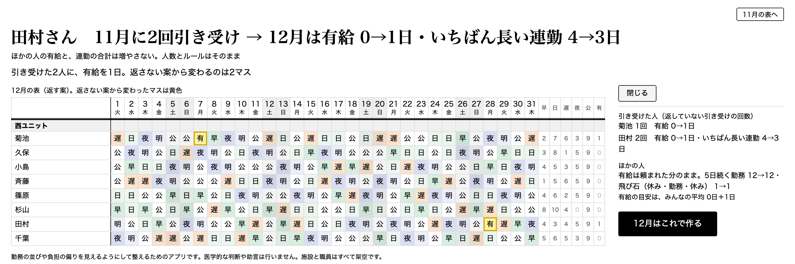
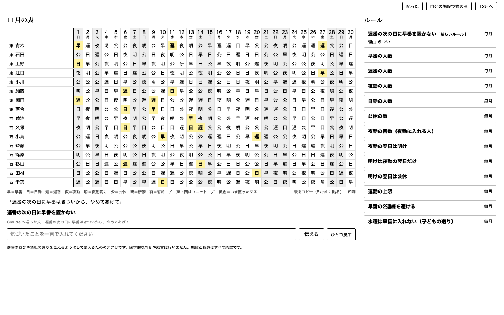
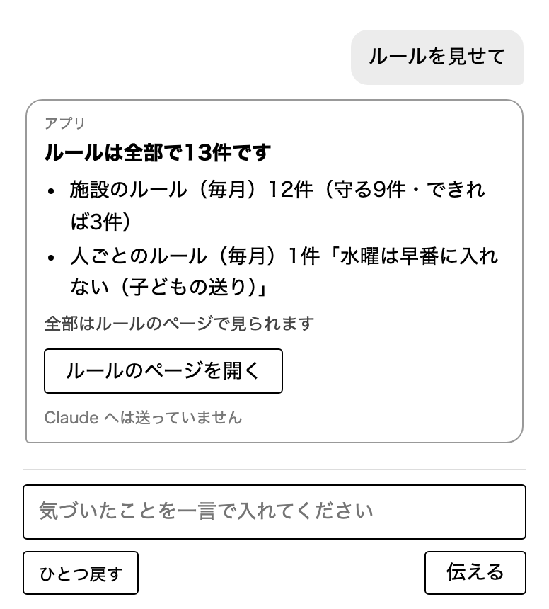

# KaigoShiftVoice

話した言葉で直せる、介護施設の勤務表のアプリです。施設ごとに違うルールを Claude が言葉のまま読み、表を作る計算のプログラムが毎日の人数や休みの数を守ったまま表を直します。急な休みの代わりを誰が引き受けたかを記録し、その人に翌月の表で返す案も出します（Built with Claude: Japan 2026 の作品）。

- 勤務の並びや負担の偏りを整えるためのアプリです。医学的な判断や助言は行いません
- 施設（ひだまりの郷・こもれびの家）と職員は、すべて架空です

細かい手順、できることの全部、測った数は [docs/details.md](docs/details.md) にあります。


## なぜ作ったか

シフトで働く人の健康は、本人の心がけだけでは守れません。早寝早起きや週末の休みといった健康法の多くは9時5時で働く人向けですが、施設で働く介護職員（全国に約103万人。入所系の施設、2024年度）は、いつ働くかをほとんど選べないからです。作者の職場では、遅番の日は22時15分に退勤し、次の日が早番なら6時45分に出勤です。家にいられるのは長くても8時間半です。国の睡眠のガイドにも、勤務の間が12時間未満の人は疲れやストレスをより感じている、という調査が載っています（厚生労働省「健康づくりのための睡眠ガイド2023」2024年2月、[PDF](https://www.mhlw.go.jp/content/001305530.pdf) の15枚目。介護職に限った調査ではなく、日本の労働者を対象にした報告です）。この短い休みも続く連勤も、誰かが作った勤務表で決まります。

施設は、利用者のそばに誰もいない時間を作れません。誰かに急な休みが出ると、休みの日の誰かが呼び出されます。介護は気持ちを整えてから利用者の前に立つ感情労働で、突然の呼び出しは、その準備のないまま人を現場に立たせます。

しかも誰が呼び出されたかは勤務表に残らず、同じ人に偏っても見えません。架空の施設で、土日の急な休み76件を、休みの人に順に電話して頼むいつもの直し方で試算すると、電話を受けて入ったのは小島さん9回・田村さん6回で、受けた14人の平均は約3回でした。

これだけ多くの人に関わるのに、この問題には手のつけようがありませんでした。勤務表のルールは施設ごとに違い、月ごとに増えるからです。表は、リーダーや管理者が現場でフルに働きながら Excel や手書きで作るか、用意された欄から選ぶシフト作成ソフトを使うかでした。国が書き方の見本として作った勤務表の記載例（厚生労働省の標準様式）でも、特定施設の28人の表に、遅番の次の日の早番が26回ありました。このアプリで翌月の表を作ると、0回になりました。

作者は介護施設で毎月シフトを作っています。作者の見るところ、売っているシフト作成ソフトは、介護の現場とはこういうものだろうという最大多数の形に寄せて作るしかありません。ある会社のシフト作成ソフトを試した時は、一人だけに有給が5日まとめて入り、これをならすには、設定画面で有給の上限を1日にそろえるしかありませんでした。

作者が欲しかったのは、全体の負担をならした後、残った日数の中でそれぞれが取れる範囲で有給を取り、今月取れなかった人は来月取れる、という決め方でした。作者が試した範囲では、多くのソフトでこれを設定できませんでした。ところが Claude Code に計算のプログラム（OR-Tools のソルバー）を使わせて試すと、この決め方も、施設ごとの細かなルールも、言葉で伝えるだけで組めると分かりました。驚くほど簡単でした。

ただ、誰もが Claude Code にソルバーを使わせて表を作れるわけではありません。作者もそれほど得意ではありません。そこで、Claude API を使って、勤務表を作る人なら誰でも、施設のルールを話した言葉のまま足して表を直せるようにしたのがこのアプリです。ここが、この作品の肝です（有給の決め方のように、まだ一言では言えないルールもあります。下の「まだできないこと」）。

## 審査員の方へ

デモ動画（3分）は11月8日に公開し、ここにリンクを置きます。

1. GitHub の［Code］→［Download ZIP］で取り込んで展開します（git clone でもかまいません）
2. uv（Python のソフトウェアをそろえるプログラム）が無ければ入れます。Mac は `curl -LsSf https://astral.sh/uv/install.sh | sh`、Windows は `powershell -ExecutionPolicy ByPass -c "irm https://astral.sh/uv/install.ps1 | iex"` です。入れた後はターミナルを開き直します
3. 展開したフォルダをターミナルで開き、次の一行を打ちます。はじめての起動は、必要なソフトウェアの取り込みで1〜2分かかり、その間は画面に何も出ないことがあります

```
uv run shiftvoice demo --base-date 2026-11-30
```

ブラウザに、ひだまりの郷の11月の表が開きます。ひだまりの郷は2ユニット16人の架空の施設で、最初の11月には毎日の人数・公休の数・夜勤の回数などのルールが12件入っています（表の上の［ルール（12件）］）。鍵を聞かれたら、鍵があれば貼って Enter、無ければ Enter だけで始まります。ほかの起動ですでに開いている時は、そのターミナルで Ctrl+C を押して止めてから起動します。ほかのアプリが 8765 番を使っている時は、一行の後ろに `--port 8766` を足します。

`--base-date 2026-11-30` は、引き受けの記録を11月30日の分まで数える指定です。11月を終えた後の場面を見せるために付けます。ダブルクリックや Codespaces で開くと今日までの記録しか数えないので、11月22日より前は下の「引き受けた人に翌月返す」の回数が少なく出ます。その時は Ctrl+C で止め、この一行で起動し直してください。

### 鍵なしで、文字だけで試す（5分）

鍵なしの2つは、表を作る計算の部分です。Claude が一言を読む所は、下の「鍵があれば、一言で直す」で試せます（鍵が無い時は写真で見られます）。

1. **引き受けた人に翌月返す。** ［12月へ］を押し、「12月の希望休」の欄は空のままで［12月の表を作る］を押します。「田村さん　11月に2回引き受け → 12月は有給 0→1日・いちばん長い連勤 4→3日」と出て、引き受けた人の有給を使う日が黄色のマスで入ります
2. **今の Excel の表から始める。** ［自分の施設で始める］→「見本（架空の施設）を貼ってみる」→［読み取る］→［12月の表を作る］。次の勤務までの間が短い並びが「11月 22回 → 12月 0回」と出ます。見本は、ひだまりの郷とは別の架空の施設、こもれびの家です。ひだまりの郷へは、画面の上の施設を選ぶ欄で戻れます

<!-- （画面） 写真は画面の作り替えの前の物 -->


### 鍵があれば、一言で直す

Ctrl+C で止めて `uv run shiftvoice demo --reset --base-date 2026-11-30` で起動し直します（ひだまりの郷を最初の11月に戻します）。鍵を聞かれたら貼って Enter を押します。右のチャットに「遅番の次の日に早番はきついから、やめてあげて」と打って［伝える］を押し、「毎月ですか、今月だけですか」に［毎月］と答えます。当てはまっていたマスが黄色く光って直り、案内が「遅番の次の日に早番は11か所 → 0か所」に変わります。続けて次の2つを伝えます（デモ動画と同じ順です）。

- 「みんな、遅番が3日も4日も続くのはやめて」。遅番の続きは2日までになります（1つ目の直しの後にできた、遅番が3日以上続く所 2か所 → 0か所。この数は画面には出ず、直す前と後の表を数えた物です。直した後に0か所になることは tests/test_even_out.py が確かめています）
- 「早番も遅番も、可能な範囲で平均化して」。全員の早番と遅番の回数を、何回とは決めずにできるだけそろえる毎月のルールになり、返事に回数の幅の行が出ます（見本で試すと「早番は1人2〜7回 → 3〜4回」「遅番は1人1〜6回 → 3〜4回」。勤務の総数は変えず、ほかのルールの外れも増えません）

「岡田さん、15と16は法事で休み」も試せます。チャットでルールを聞くこともできます。「外れているルールは？」「ルールを見せて」「ルールを整理して」と聞くと、Claude へは送らず、アプリが手元で答え、ルールのページと整理の画面を開くボタンを出します（返事の吹き出しには「アプリ」と出ます）。「使い方を教えて」と打つと、言える一言の例が出ます（鍵なしでも出ます）。





### 声で試す（任意）

声は、このパソコンの中だけで文字にします（外へは送りません）。はじめての時は音声認識のモデル（約2.4GB）を取り込みます。`uv run --extra voice shiftvoice demo --voice` で起動し、スペースキーを押している間に一言話すと（［話す］と［話し終えた］でも同じです）、打った時と同じように表が直ります。

待機当番と休みの電話、希望休、ルールの整理などのほかの場面は、[docs/details.md](docs/details.md) の「手順（10分）」にあります。

## このアプリがすること

勤務表を作る人の毎月の順に沿って、次のことができます。

- 今の Excel の勤務表（国の標準様式も）を貼ると、職員・勤務・ルールを見つけ、次の勤務までの間が短い並びを避けた翌月の表を作る
- 希望休を一言か「希」を書いた表で先に入れ、守って作る
- 毎日の人数や夜勤の翌日の明けなど、動かせないルールは計算が外さずに守る。どうしても組めない時は相談できるルールから外し、どれを外したかを画面に出す
- 「杉山さんは日勤だけ」のような一言で表を直す。毎月か今月だけかがあいまいな時は聞き返す。待機当番のような、表に無い仕組みも言葉で足せる。「早番も遅番も、可能な範囲で平均化して」のような、全員の回数をそろえるルールも入る。ルールはチャットで聞けて、表の上の［ルール］で全部を見られる
- 急な休みを引き受けた人に、翌月の表で有給を使う日を1日入れ、いちばん長い連勤を1日短くする案を、返さない案と並べて出す。採るかどうかは施設が決める
- 全部のルールを守れない日が残ると、理由1つと、穴を埋める提案1つを出す。何か月も表を変えていないルールは、片付けの候補に出す
- 作った表を施設の Excel に貼り戻し、A4 横で印刷する（表の上の帯のボタン）

返す案について、同僚の介護員5人に場面の短い文を読んでもらうと、頼まれて入る時の不公平感や負担感は、5人とも「軽くなる」という答えでした（アプリを使ってもらった後の答えではありません）。


## Claude の使い方

Claude の受け持ちは、言葉を読むことです。表を作る計算と値の確かめはアプリのプログラム（OR-Tools）が行い、採るかどうかは人が決めます。

デモ動画の3つの一言と、待機当番の一言は、次のように読まれて表に入ります（右の列は画面に出る文です）。

| 言った言葉 | 読んだ Claude | 画面に出るルール |
|---|---|---|
| 遅番の次の日に早番はきついから、やめてあげて | Claude Haiku 5.5 | 遅番の次の日に早番を置かない |
| みんな、遅番が3日も4日も続くのはやめて | Claude Haiku 5.5 | 全員 遅番は続けて2日まで |
| 早番も遅番も、可能な範囲で平均化して | Claude Haiku 5.5 | 全員 早番と遅番の回数を、それぞれできるだけそろえる |
| 毎月、土日は休みの人から待機1人。急な休みの電話はその人にだけ。引き受けた回数は、翌月も覚えておいて | Claude Haiku 5.5 が読み、Claude Sonnet 5.5 が組み立てる | 7種類のルールではなく、表の下に待機当番の行ができる（表に無い仕組みの定義を組み立てる） |

Claude Haiku 5.5 は一言を決まった型に読み、アプリがそれを、計算のプログラムが扱える7種類のルール（人と日のマス・月の回数・1日の人数・続けて働く日数・並び・曜日・平均化）に直します。どれにも当たらない時は、表に無い当番なら Claude Sonnet 5.5 が組み立て、それ以外は Claude Sonnet 5.5 が施設のルールの一覧を添えて読み直します。それでも表せない頼みは、表を変えずに聞き返すか、まだ扱えないと伝えます（言えない頼みは下の「まだできないこと」）。

- 一言を読むのは Claude Haiku 5.5 です。型と例を渡して JSON だけを返させます。1回2秒ほど・0.05円ほどで、待たせません
- 表に無い当番（待機当番・入浴係・送迎）の組み立て、最初の読みで止まった一言の読み直し、ルールの整理は Claude Sonnet 5.5 です
- 送る前に名簿の名前を「職員01」のような番号に伏せ、返事で戻します。チャットでルールを聞く問いは Claude へ送らず、アプリが手元で答えます。途中で切れた返事は使いません

いちばん詰まったのは、作者がふだんの言い方で話すと、一言がほとんど通らなかったことです。11月7日の夜に作者が自分で使うと、たとえば「遅番を4日以上入れるのはやめよう」は「『遅番は3日まで』と言ってください」と返されました。原因は、Claude Code のエージェントが、台本で決めた一言だけで指示文を磨き、試験もその一言で確かめて「できた」と報告していたことでした。その夜、作者の施設の翌月の表で止まった一言を1つずつ直し、読めずに止まった時だけ施設のルールの一覧を添えて Claude Sonnet 5.5 に読み直させる仕組みを足しました。そのうえで、現場の言い方150件を本物の Claude に読ませて測り直しました。正しく拾えた割合は79%から88%に上がりました。ただ、この150件は直しながら何度も使ったので、練習した問題で点が上がったのに近い数字です。直した後に新しく作った50件の言い方で試すと、82%でした。その前にも、手で書いた返事で試験が全部通っていたのに、本物の Claude Haiku 5.5 では一言36件中16件しか合わなかったことがあり、本物の返事を録って比べるプログラムで、3周108回とも合う所まで上げました。

- 例に使っていない言い方20件を3回ずつ読ませると、間違えて表やルールを変えたのは60回中0回でした（名前や日付が足りない一言は聞き返します）
- 待機当番の組み立ては、10回とも同じ定義になりました。表せない「第2水曜」は、10回とも作らずに聞き返しました

## 動かし方・鍵の入れ方

いるものは [uv](https://docs.astral.sh/uv/) と、自分の Claude の API の鍵です。鍵が無くても、表を見ること、Excel の表から翌月の表を作ること、返す案を見ること、「希」の表で希望休を入れることはできます。

- Mac は、GitHub の［Code］→［Download ZIP］で取り込み、`はじめる.command` をダブルクリックします。はじめての時は「開発元を確認できない」と出るので、右クリック →［開く］で開きます
- Windows は、同じように取り込み、`はじめる.bat` をダブルクリックします
- ターミナルでは、上の「審査員の方へ」の1〜3のとおりです

ブラウザで http://127.0.0.1:8765/ が開きます（このパソコンの中だけで開くサーバーです）。最初の状態に戻す時は `uv run shiftvoice demo --reset` です。OR-Tools は OS ごとに解き方の道筋が違うので、Windows や Linux では休みを移す日などが写真と違うことがあります。どの答えもルールは守ります。

インストールせずに試す時は、GitHub にログインして https://codespaces.new/KAPI-cOde/KaigoShiftVoice を開き、［Create codespace］を押します。2〜3分でブラウザの中でアプリが起動します（声は使えません。一言で直す時は、先に Codespaces のシークレットに `ANTHROPIC_API_KEY` という名前で鍵を入れます。返す案は [docs/details.md](docs/details.md) の手順5）。

鍵は Claude Console（https://platform.claude.com/）で作れます。鍵が無いまま起動すると鍵を聞きます（入力は表示されません）。保存を選ぶと、このフォルダの `.env`（Git に入りません）に書きます。自分で `.env` に書く方法は [docs/details.md](docs/details.md) の「鍵の入れ方」にあります。

試験は `uv run pytest -q` で、1426件が通ります（2026-11-08。声のモデルなど手元に無い物が要る8件は飛ばします）。本物の Claude で録った返事で回るので、鍵は要りません。

## 費用とデータ

費用は Claude の利用料だけで、自分の鍵で払います。一言を1回読むと0.05円ほど、1か月に100回話して5円ほどで、待機当番のような新しい仕組みを足す時だけ1回0.5円ほどです（2026-11-05 に測った量を、公式の料金と1ドル150円で計算した目安）。表を作る計算、声を文字にすること、Excel の取り込みは、このパソコンの中で動くので費用はかかりません。

| 外へ出る物（Claude へ送る） | 出ない物（このパソコンの中だけ） |
|---|---|
| 打った・話した一言と、表を配った後のルールの理由の文（名簿の名前は「職員01」のような番号に置き換える） | 勤務表、職員の名簿、ルールの帳面のほかの中身、引き受けの記録、声 |

利用者の情報は扱いません。「さん」の付かない名簿にない名前などは、番号に置き換えられず、そのまま送られることがあります。伝えた後は、Claude へ送った文をそのまま画面に出します。サーバーは 127.0.0.1 だけで開き、外からはつながりません。

## まだできないこと

- 締めが月末でない表（16日から翌月15日など）と、夜勤が2種類ある3交代の表（準夜・深夜）は読めません
- 職員が100人を大きく超える施設は試していません（国の記載例を56人・84人・100人に増やした表では、短い並びが0回になり、作るのに14〜19秒でした）
- 待機当番そのものの負担（公休の日に電話を待つこと）、本人の同意、待遇は確かめていません
- 作れなかった日の提案は、1日分・1人に頼む形だけです。ルールの整理の「AI の見立て」は外れることがあるので、片付ける前に人が読んで決めます
- 有給をなるべく平等に入れ、割り切れない分は先月の有給が少ない人に入れる決め方は、プログラムの外のルールの記録へ直接入れる形で動きます。一言ではまだ言えず、見本の施設にも入っていません
- 施設ごとの言い方とルールを覚えていき、一言を読む時に、その施設の文脈（ルールの一覧・名簿・これまでのやり取り）を Claude に渡す仕組みは、まだ第一歩です。作者が Claude Code に話すと通じる言い方が、アプリからは通じないことがありました。比べると、その差は Claude に渡す文脈の量の差でした。今は、最初の読みで止まった時だけ、施設のルールの文脈を添えて Claude Sonnet 5.5 が読み直します
- Windows では、作者はまだ自分の PC で動かしていません（GitHub の Windows の機械で、起動・保存・審査員の手順・見本の表の試験（8件）が通ることは確かめました。声は未確認です）

ほかは [docs/details.md](docs/details.md) の「まだできないこと」にあります。

## 作り方について

アイデアと仕様の構想、Claude Code で試した結果は、期間の前にリポジトリの外で得ました。その時のコードは持ち込んでいません。このリポジトリのコードは、ハッカソンの期間中（2026-11-02 から）にすべて新しく書きました。コミットは457件（2026-11-02〜11-08）で、すべて Claude Code と作りました。

メインの Claude が設計と検収をし、画面や調べものはサブエージェントに任せました。書いた側とは別のサブエージェントに、壊す側・個人情報・施設で表を作る人・審査員の目で差分を読ませ、見落としを減らしています。Claude Code の設定（`CLAUDE.md`、`.claude/` の役・スキル・フック）もこのリポジトリに入れています。進め方と詰まった所は [docs/development.md](docs/development.md) と [docs/failure-catalog.md](docs/failure-catalog.md)、測った数は [docs/measurements.md](docs/measurements.md) にあります。

## 使っているオープンソースのソフトウェアとライセンス

| 名前 | 使い道 | ライセンス |
|---|---|---|
| OR-Tools（CP-SAT） | 勤務表を作る計算 | Apache-2.0 |
| Anthropic Python SDK | Claude Haiku 5.5 と Claude Sonnet 5.5 を呼ぶ | MIT |
| Haas-ja-v1.0（Third Intelligence） | 日本語の音声認識の元のモデル（声で試す時だけ） | Apache-2.0 |
| oboroge0/Haas-ja-v1.0-onnx | 上のモデルを sherpa-onnx で動かす変換版（版 2c2133a を固定） | Apache-2.0（配布の記載） |
| sherpa-onnx・sherpa-onnx-core | 音声認識を動かす | Apache-2.0 |
| ONNX Runtime | モデルの推論（sherpa-onnx-core に同梱） | MIT |
| huggingface_hub | モデルの取り込み | Apache-2.0 |
| NumPy | 音声の配列 | BSD-3-Clause |

## ライセンス

MIT（作者 KAPI-cODe）
