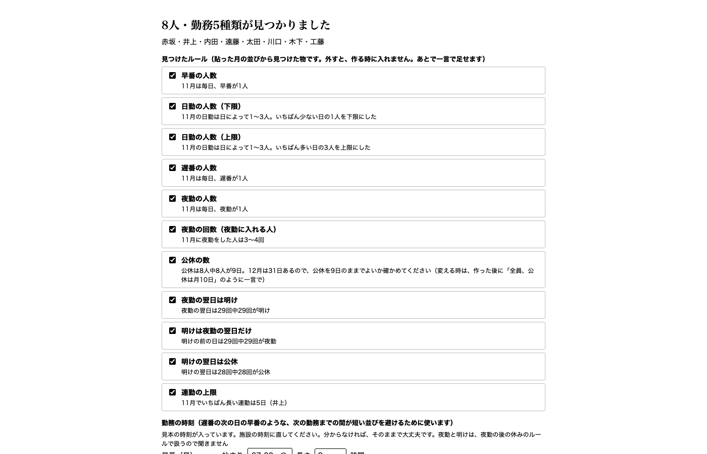
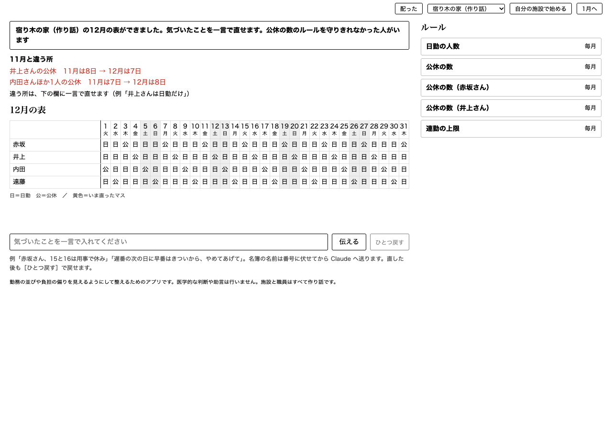
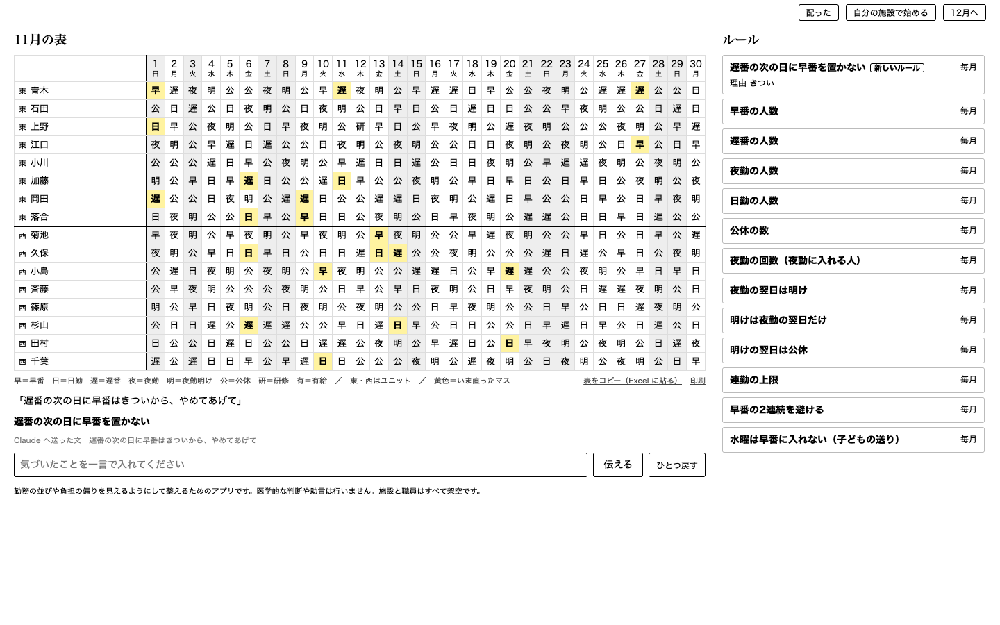
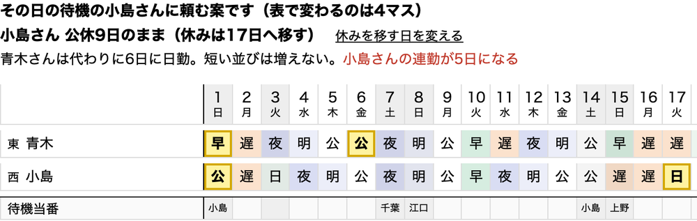
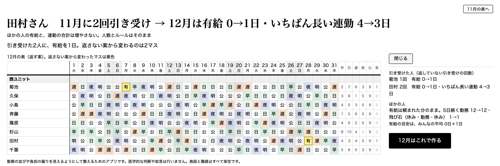
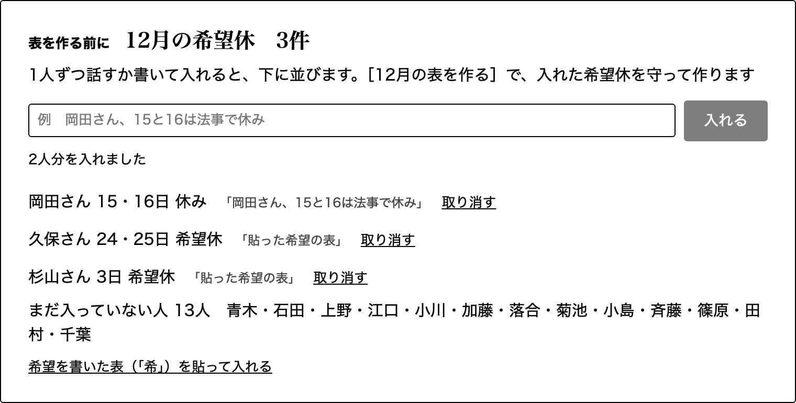
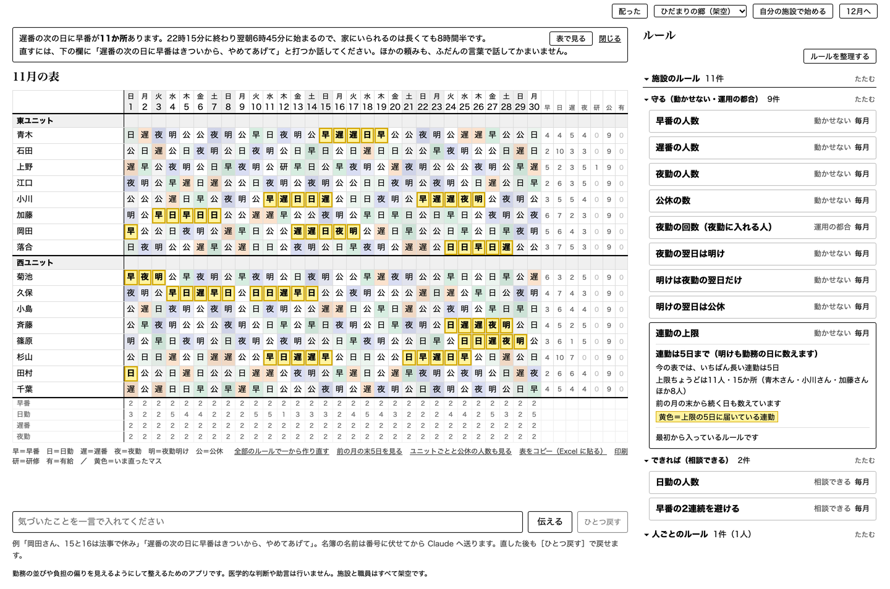
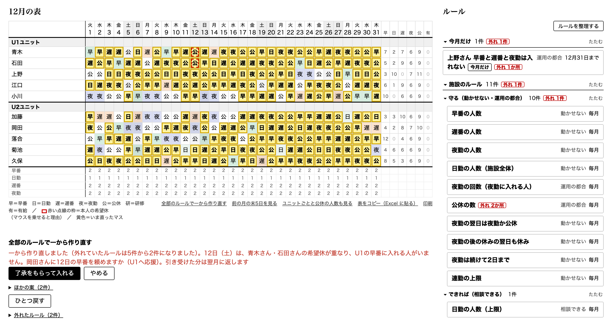
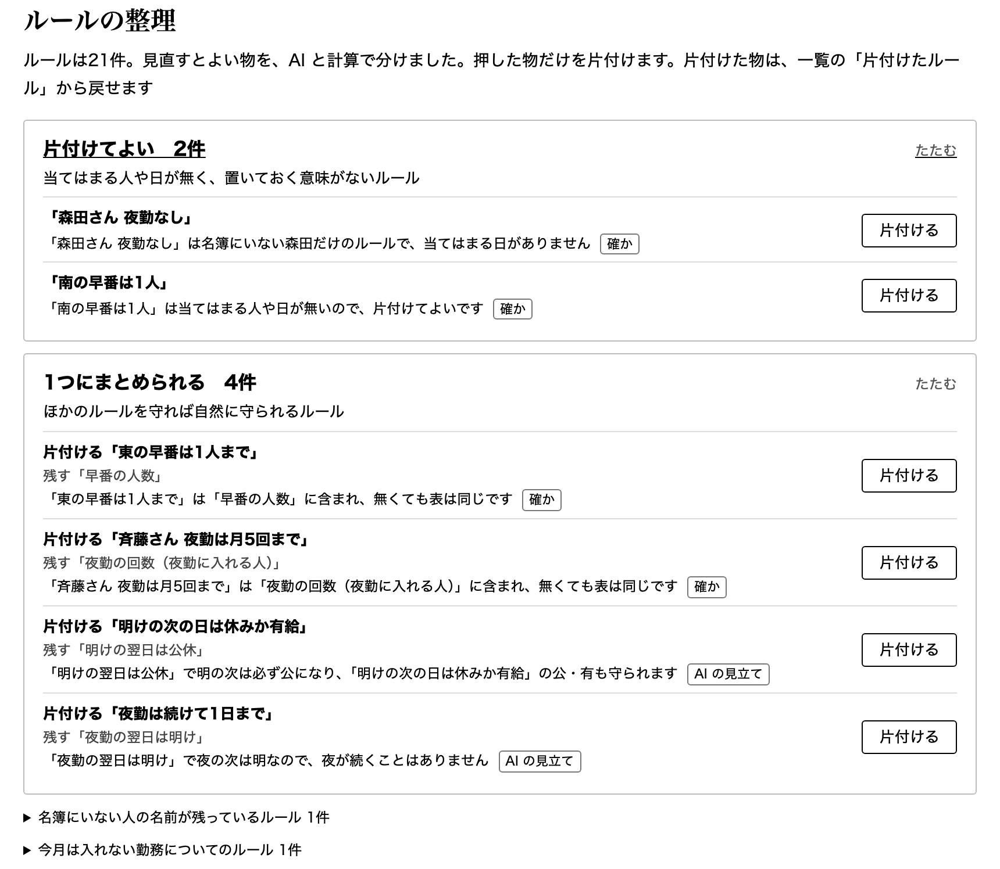
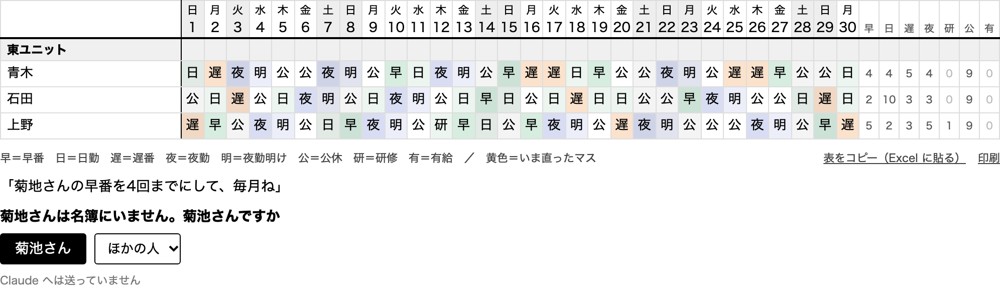

# 詳しい説明

README を短くした時に、前の README から移した詳しい説明です（2026-11-08）。概要と、審査員の方が5分で試す手順は [README](../README.md) にあります。測った数の測り方は [measurements.md](measurements.md) にあります。

<!-- （画面） この文書の写真と、ボタンや欄の場所の書き方は、画面の作り替え（操作のボタンを表の上へ、ルールの一覧を別のページへ）の前の物 -->

## なぜ勤務表なのか

シフトで働く人の健康は、本人の心がけだけでは守れません。早寝早起きや週末の休みといった健康法の多くは9時5時で働く人向けですが、全国に約103万人いる施設の介護職員は、いつ働くかをほとんど選べないからです。遅番の次の日の早番のような短い休みも、続く連勤も、自分ではない誰かが作った勤務表で決まります。作者の職場では、遅番の日は22時15分に退勤し、次の日が早番なら6時45分に出勤です。家に帰って風呂に入ると、眠れるのはどんなに早くても23時半で、それも定時に帰れた日の話です。

施設は、利用者のそばに誰もいない時間を作れません。多くの施設はぎりぎりの人数で回っていて、早番・遅番・夜勤のどれかが1人欠けるだけで、その日が回らなくなります。だから有給は取りにくく、誰かに急な休みが出た時は、休みの日の誰かが呼び出されます。

介護は、気持ちを整えてから利用者の前に立つ感情労働です。休みの日の突然の呼び出しは、その準備のないまま人を現場に立たせます。休みを別の日に移しても、その負担は埋め合わせきれません。しかも、誰が呼び出されたかは勤務表に残らず、同じ人に偏っても見えません。

介護の質は、介護員の体と心の余裕に支えられています。疲れや不公平感は、利用者への気配りや、この仕事を続ける気持ちを削ります。

これだけ多くの人に関わるのに、この問題には手のつけようがありませんでした。勤務表のルールは施設ごとに違い、月ごとに増えるからです。表は、リーダーや管理者が介護員として現場でフルに働きながら時間をこじ開けて、Excel や手書きで作るか、お金を払って、用意された欄から選ぶ制約の多いシフト作成ソフトを契約するかでした。手で作れば、毎日の早番・遅番・夜勤の人数、一人ずつの夜勤の回数と希望休、資格や組み合わせを同時にそろえるだけで手一杯になり、休みの間隔までは目が届きません。ソフトには施設ごとのルールが収まりきりません。国が書き方の見本として作った勤務形態一覧表の記載例（厚生労働省の標準様式、令和6年3月告示分。https://www.mhlw.go.jp/stf/kaigo-shinsei.html ）でも、特定施設の28人の表に、次の勤務までの間が14時間に満たない並びが26回あり、26回とも遅番の次の日の早番でした（数え方は [measurements.md](measurements.md)）。

Claude なら、施設ごとに違うルールを、その施設の言葉のまま読めます。このアプリは、今の Excel の勤務表を貼り、見つけたルールと記号を確かめると、休みの間隔が短い並びを避けた翌月の表を作ります。施設ごとのルールや、急な休みの代わりを誰に頼むかは話した言葉で直し、呼び出しを引き受けた人には翌月の表で報います。パソコンの中で動き、費用は Claude の利用料だけです（一言の読み取り100回で5円ほど。測り方は下の「費用とデータ」）。

| Excel の表を貼ると、見つけたルールが出る | 作った翌月の表。次の勤務までの間が短い並びの数と、前の月と違う所が出る |
|---|---|
|  |  |

## 誰の、どんな困りごとか

施設（入所系）で働く介護職員は約103万人です（2024年度。厚生労働省「介護職員数の推移」、社会保障審議会 介護給付費分科会、2026年8月28日、https://www.mhlw.go.jp/content/12300000/001743314.pdf ）。介護職員は2026年度に約240万人が必要で、2022年度より約25万人多いとされています（厚生労働省、2024年7月12日、https://www.mhlw.go.jp/stf/newpage_41379.html ）。

作者は介護施設で毎月シフトを作っています。毎月の勤務表づくりは、作り直しを含めて5〜10時間かかります。介護員にも、ほかの仕事と同じように急な出来事があります。作者も子育ての時期で、子どもが体調を崩して休む日があり、母の急病で病院へ行く日もありました。そういう時は、ほかの人が休みの日に出て支えてくれます。組んだ後のこうした急な休みは月に1〜3回あり、そのたびに代わりを頼む電話を2〜3人にかけて決まります。ただ、支える側はおおむね同じ人に偏りがちで、その人たちに報いる方法は、ほとんどの施設で無いように見えます。その負担は表に残らず、翌月の表は何もなかったように組まれます。

同僚の介護員数人にも聞きました（名前は記録していません）。11月4日は、おおむねの傾向として、遅番の次の日の早番は「論外」。急な休みの穴埋めは「施設に誰もいない時間は作れないので、引き受けざるを得ない」。引き受けた人に翌月報いる仕組みは「引き受けやすくなるというより、心理的な不公平感と負担感がなくなる」という答えでした。11月5日に、場面の短い文を読んでもらって3択（軽くなる・変わらない・重くなる）で聞くと、休みの日に頼まれて入った人の翌月の表に有給を使う日が1日入り、いちばん長い連勤が1日短くなる時、頼まれて入る時の不公平感や負担感は、5人とも「軽くなる」でした。遅番の次の日の早番が無い来月の負担は「この施設ではもう組んでいないので考えにくい。組んでいたら当然軽くなる」という答えでした（どちらもアプリを使ってもらった後の答えではありません。聞いた文は [measurements.md](measurements.md)）。

架空の施設「ひだまりの郷」の11月の表で、偏りを試算しました（`uv run python tools/absence_sim.py`）。土日に勤務の人が1人ずつ急に休んだ全部の場合76件を、休みの人に順に電話して頼む、いつもの直し方で試すと、46件でその日休みの人に電話が要りました。電話を受けて入ったのは、小島さん9回・田村さん6回でした（電話を受けた14人の平均は約3回）。

ルールは月ごとに増えます。「遅番の次の日に早番はきつい」「この人は試験までは夜勤3回まで」。こうした一言は作成者の頭の中とメモに散らばり、試験が終わった後も残って表を縛ります。

## 手順（10分）

押すボタンと話す一文まで書いた手順です。10分ほどで試せます（声で試す時は、はじめてだけ声のモデルの取り込みに数分）。声のかわりに同じ一文を打っても動きます。Claude の鍵が無い時に試せるのは、1・2・5・6（「希」の表を貼る方）・7・8です。声や一言で直す3と4の結果は、手順の下の写真で見てください。

1. **起動する。** Mac はこのフォルダの `はじめる.command` をダブルクリック、Windows は `はじめる.bat`、ターミナルなら `uv run shiftvoice demo`。はじめての時は必要な物をそろえるのに1〜2分かかり、ブラウザに架空の施設「ひだまりの郷」の11月の表が開きます。ターミナルで鍵を聞かれた時は、何も入れずに Enter を押すと鍵なしで始まります。声で試す時は下の「声で試す（任意）」、インストールせずに試す時は「インストールせずに試す（GitHub Codespaces）」へ（声は使えません）
2. **鍵なしで、勤務表を貼って来月を作る。** ［自分の施設で始める］→ 貼る欄の下の「見本（架空の施設）を貼ってみる」→［読み取る］→［12月の表を作る］。画面の上に「次の勤務までの間が短い並び（14時間未満。遅番の翌日の早番など）　11月 22回 → 12月 0回」と出ます。2回目に同じ見本で作ると、前に作った施設を開くだけでこの行は出ません。もう一度見る時は、施設の名前の欄を別の名前にして作ります。
3. **声で直す（Claude の鍵が要ります）。** 2で取り込んだ時は、先に施設を選ぶ欄で「ひだまりの郷」に戻します。［話す］を押して「遅番の次の日に早番はきついから、やめてあげて」と話し、［話し終えた］を押します（スペースキーを押している間だけ話して、離しても同じです。声で起動していない時は、同じ一文を欄に打って［伝える］）→「毎月ですか、今月だけですか」に［毎月］。ルールの一覧に「遅番の次の日に早番を置かない」が増え、当てはまっていたマスが黄色く光って直ります。ほかに「岡田さん、15と16は法事で休み」「小島さん、29日に試験だから、それまで夜勤3回まで」も試せます
4. **今までなかった仕組みを足し、急な休みの穴埋めを記録する（鍵が要ります）。** 「毎月、土日は休みの人から待機1人。急な休みの電話はその人にだけ。引き受けた回数は、翌月も覚えておいて」と話す（または打って［伝える］）（表の下に待機当番の行ができます）→ ［配った］→「青木さんから電話で、11月1日の日曜、お休みしたいって」と話す → その日の待機の人に頼む案（公休は減らさず、休みを別の日へ移す）が出るので［了承をもらって直す］。その人の名前の横に「11月の引き受け」の回数が出ます
5. **翌月に返す案を見る（鍵は要りません）。** 起動したターミナル（はじめる.command で開いた窓も同じ）で Ctrl+C を押して止め、`uv run shiftvoice demo --base-date 2026-11-30` と日付を付けて起動し直すと、ひだまりの郷を11月末として開きます（用意した11月の引き受けの記録を、そのまま数えます）。［12月へ］→ 表を作る前に「12月の希望休」の欄が出ます（何も入れなければ前と同じ数で作ります。入れる時は下の手順6）→［12月の表を作る］（計算の間、秒数が出ます。画面の上の「見直したルール」は、変更が無ければ見出しだけです。3と4を試した後は、今月足したルールのカードが出るので、カードごとに［今月も使う］などを選ぶと、［12月の表を作る］が出ます）。「田村さん　11月に2回引き受け → 12月は有給 0→1日・いちばん長い連勤 4→3日」と出て、引き受けた2人（田村さん・菊池さん）の有給を使う日が黄色のマスで入ります。［詳しく見る］で、引き受けた人ごとの回数と前後、ほかの人の5日続く勤務と飛び石（休み・勤務・休みと、勤務が1日だけ挟まる並び）の数が出ます。用意した記録で数えているので、3と4を試した後は小島さんの引き受けの記録が増えます。この案で決める時は［12月はこれで作る］を押します
6. **希望休を先に入れる（鍵は要りません。一言で入れる時は鍵が要ります）。** 5の手順で［12月へ］まで進み、「12月の希望休」の欄に、「岡田さん、15と16は法事で休み」のように一言で入れます。「希望を書いた表（「希」）を貼って入れる」を開き、1行目に日の番号、左の列に名前、希望の日に「希」と書いた表を貼って［取り込む］でも入ります（Claude は呼びません）。Excel からのコピーのほか、次のようなタブ区切りの文字でも入ります。

   ```
   	1	2	3
   久保		希	
   杉山			希
   ```

   入れた分は、言った言葉と［取り消す］つきで並び、まだ入っていない人の名前も出ます。［12月の表を作る］で、入れた希望休を守って作ります
7. **ルールの中身を見る（鍵は要りません）。** ルールの一覧で、ルールを1つ押します（例は［連勤の上限］）。ルールの数と、今の表の余りが出て、上限に届いたマスだけが黄色く光ります
8. **最初の状態に戻す。** 起動したターミナルで Ctrl+C を押して止め、 `uv run shiftvoice demo --reset`（ひだまりの郷を最初の状態に戻して、そのまま起動します。2で作った施設は残ります）

| 手順3の結果（場面1。一言がルールになり、当てはまっていたマスが直って光る） | 手順4の結果（休みの電話で、その日の待機の人に頼む案。公休は減らさず、休みを別の日へ移す） |
|---|---|
|  |  |

手順5の結果（場面2。引き受けた人に返す案。有給を使う日が黄色のマスで入り、［詳しく見る］に引き受けた人ごとの前後が出ます。表は西ユニットの8人だけに寄せています）



手順6の結果（［12月へ］の後、表を作る前に出る「12月の希望休」の欄。3人分を入れた所で、言った言葉と［取り消す］が並び、まだ入っていない人の名前が出ています）



手順7の結果（ルール［連勤の上限］を押した所。数と今の表の余りが出て、上限の5日に届いている連勤のマスが黄色で光ります）



手順で試さない2つの場面の写真です（どちらも作り話の施設で、録った返事で動かした画面です）。1つ目は、［全部のルールで一から作り直す］の後に、守れなかった日の理由1つと、穴を埋める提案1つ、［了承をもらって入れる］が出た所です。



2つ目は、［ルールを整理する］を押した所です（ルールを足した試験用の施設で見ています）。片付けてよい2件と、1つにまとめられる4件が理由1行ずつ並び、計算で言える物には「確か」、Claude の見立てには「AI の見立て」が付いています。



写真は、本物の Claude で録っておいた返事で動かした画面です（3・4・6の写真は、縮めても読めるように、画面の一部を切り出しています。3と4は表の一部を縦に並べています）。

鍵は下の「鍵の入れ方」、声で試す時は「声で試す（任意）」にあります。

## 要点（期間中に測った数）

| 測った事 | 結果 |
|---|---|
| 次の勤務までの間が短い並び（14時間未満） | 見本の施設（こもれびの家）22回→0回。国の様式の記載例は特養（特別養護老人ホーム）28人 30回→1回・特定施設28人 26回→0回（夜勤などの1日の人数は貼った月の幅のまま）。市が公開している記入例でも、短期入所10人 16回→0回・小規模多機能16人 6回→0回 |
| 一言の読み取り（Claude Haiku 5.5） | デモ動画と試験で使う一言36件を3周108回すべて、決まった形（休み・回数のルールなど）に正しく読んだ（直す前は36件中16件）。話して足す勤務などを足した44件も、11月6日の夜に1周44回すべて正しく読んだ |
| 例に使っていない現場の言い方（Claude Haiku 5.5） | 別の AI が書いた現場の言い方20件を3回ずつ。直すのが正しい12件は36回中34回正しく直し（残りの2回は聞き返した）、名前や日付が足りない・言った勤務が表と違うなど聞き返すのが正しい8件は24回とも聞き返した。間違えて表やルールを変えたのは60回中0回（頼んだ人と日のほかの人や日のルールが増えた時も、間違いに数える）。2人の勤務の入れ替えも直せる |
| 現場の言い方150件（言いよどみ・ていねいなど。本物の Claude） | 正しく拾えた割合が79%（118件）から88%（132件）に上がった（残りは止まった15件・違う3件）。同じ150件を見て直したので、初めて見る言い方では下がることがあり、直した後に作った初めて見る言い方50件では82%（41件）でした。AI の声を音声認識に通した声の60件では52件（87%） |
| 表に無い当番の定義の組み立て（Claude Sonnet 5.5） | 待機当番は10回とも同じ定義。入浴係・送迎も10回中10回。表せない「第2水曜」は10回とも作らずに聞き返す |
| 引き受けた人に返す | 11月に急な休みの代わりに出た3人に、12月は有給 0→1日・いちばん長い連勤を1日短く。ほかの人の有給は頼まれた分のまま、5日続く勤務もほかの人の合計では増やさない |
| 試験 | `uv run pytest -q` で1328件が通る（2026-11-08） |

測り方と、ほかの数は [measurements.md](measurements.md) にあります。

## このアプリがすること

勤務表を作る人の毎月の順に沿って、できることを書きます（写真は下の「手順」に）。

1. 全員の希望休を先に入れる。［12月へ］を押すと、表を作る前に「12月の希望休」の欄が出ます。一言（文字か声）か、「希」を書いた表を貼って入れると、入れた分が言った言葉と［取り消す］つきで並び、まだ入っていない人の名前も見えます。［12月の表を作る］で、入れた希望休を守って作ります
2. 動かせないルールを先に守る。毎日の人数・夜勤の翌日は明け（夜勤が朝に終わる日）などは、計算が外さずに守ります（見本の施設では公休の数も）。貼って取り込んだ施設の公休の数と夜勤の回数は「運用の都合」の強さで入るので、どうしても組めない時だけ外し、誰がいくつ外れたかを画面に出します。ルールのカードには、強さの1語（動かせない・運用の都合・本人の希望・相談できる）が付きます
3. 相談できるルールを当てる。表が作れない時は、運用の都合を先に外し、本人の希望を最後まで守る順で外します。希望休を全部守って作れるかが時間内に分からない時は、希望休を外さずに止め、いちばんの詰まり所と一緒に知らせます。ルールを外した時は、画面で知らせます
4. 確かめる。ルールの一覧でルールを押すと、数と今の表の余りが出て、上限や下限に届いたマスだけが光ります。表はユニットの見出しの行で区切り、下に日ごとの勤務の人数の行が、勤務の始まりの早い順に出ます（ふだんは施設全体だけで、［ユニットごとと公休の人数も見る］を押すと、ユニットごとと公休の人数も出ます）。ルールの一覧は「今月だけ」「施設のルール（守る・できれば）」「人ごとのルール（人の名前ごと）」に分かれ、見出しを押すとたためます。たたんでいても、今の表で外れているルールの数が赤で出ます。希望休のマスには赤い点線の枠が付き、マウスを乗せると「希望休（理由）」が出ます。［前の月の末5日を見る］で、表の左に前の月の末の5日を薄い色で出し、月またぎのつながりを確かめられます。行の右端には、その人の月の回数（早番・日勤・遅番・夜勤・公休・有給。研修と話して足した勤務は、その月に入っている時だけ）が出て、マスを直すとその場で変わります
5. おかしい所を一言で指摘する。「岡田さん、15と16は法事で休み」「杉山さんは日勤だけ」と言う（または打つ）と、その場で表が直り、ほかの人のマスも動いた時は黄色で光ります。もう守られている指摘は「もう守られています」と言い、毎月か今月だけかがあいまいな時と、開いている月と違う月の一言は聞き返します。声は、スペースキーを押している間だけ話せます（一度話した後も、スペースでまた話せます）。言い方で強さが変わります。「ハードルールで」は動かせない、「強めのソフトで」は運用の都合、「ソフトルールで」は相談できる、になります。「できれば」「なるべく」と言った頼み（「〇〇さん、29日から31日は、できれば休みにしないで」）と、「きつい」「〜してあげて」と言った並びの禁止は「相談できる」で入ります。「遅番の次の日に早番は入れないで」のように言い切った並びの禁止は「運用の都合」になります
6. 作り直す。足したルールを見直してから12月の表を作ります。直したい所が残っていれば、5の一言でまた直します。表を開いた後に、［全部のルールで一から作り直す］を押すと、全部のルールで白紙から何回か作り、いちばん良い表に置き換えます（1〜3分ほど。［ひとつ戻す］で戻せます。待機などの当番も新しい表で割り当て直します）。全部のルールを守れない日が残った時は、理由を1つと、穴を埋める提案を1つ出します（下の「作れなかった日の理由と提案」）

このほかにできること。

- 作り直す前に、人手の足りなさを数える。研修などの決まったマス、公休や有給・ほかの勤務の下限、夜勤の翌日の明けを引いた上で数え（その日だけ外した日のある回数のルールは、外した日数だけ上限を広げます）、足りない時は、表を変えずに「夜勤が〇回足りません。入れる人の上限の合計は〇回で、毎日の人数には〇回要ります。上限を上げられそうな人は…」と名前つきで言って止まります（有給消化の人は上げる候補に出しません）。何が足りないのか分からないまま、ルールだけが外れた表になるのを防ぐためです
- 一言で入れたルールが守れず、段を下げた（動かせない→運用の都合など）時は、理由1つと提案1つの2文で知らせます。外れたルールの一覧はたたんであり、開くと見られます
- 人ごと・回数・連続の言い方。「〇〇さんの夜勤はできるだけ単発で」「〇〇さんの現場勤務は8日まで」「遅番はなるべく連続2回まで、どうしようもない時は3回まで。ただし〇〇さんは当たらない」のように言えます
- ユニットと応援。ユニットごとに違う人数と、施設全体の人数を決められます。「12日、西ユニットの〇〇さんは東の遅番に入って」のような一言で、その日の勤務と応援先を決めると、見出しの行に矢印、マスに応援先の小さな字が出て、応援先のユニットの人数に数えます（元のユニットの人数からは外します）。計算が自分で応援を決めることはしません
- 全部の希望休を入れて組めない月は、表の上に、いちばんの詰まり所（どの日に、誰の希望休が重なり、どのルールと同時に守れないか）を文で出し、重なった希望休のマスに赤い枠を付けます。日勤専属の人に早出を頼む、その日の人数を一言で減らす、などの対処を先に試し、どうしても空かない時に希望休を本人と相談できるようにするためです（組めた月は何も出しません）。その日の人数は、表を作る前の「12月の希望休」の欄でも「12日は早番を2人」のように一言で言えます（その月だけのルールになります）
- 貼って取り込んだ施設で一から表を作る時、全部のルールを守る表が時間内に見つからなければ、ルールを外す前にもう少し長く探します（待ちは1〜2分ほど増えます。一言の直しの速さは変わりません）
- 行事の日など、その日だけの人数。「28日は行事なので早番を3人」「1日は西の早番はいなくていい」と言うと、その日だけのルール（今月だけ）になり、その日は同じ勤務の毎日・曜日の人数のルールが、合わない側だけその数までゆるみます。人数の頼みは1つずつ言ってください
- 表に無い勤務を言葉で足す。「8時から17時の日8を足して」と言うと、日8が表で使える勤務になり、「10日の小島さん、日8に」で置けます。足した勤務は、頼まれた時だけ置き、今ある勤務の人数には数えません。足す一言は Claude へ送らず、アプリのプログラムが読みます。日をまたぐ勤務は、まだ一言で足せません
- 施設の仕組みを言葉で足す。「土日は休みの人から待機1人。急な休みの電話はその人にだけ」と言うと、待機当番の欄ができます。休みの電話では待機の人に頼み、その人の公休は減らさずに、負担の少ない日へ休みを移します
- 引き受けた人の翌月を、少し楽にする。翌月の表を作る時、穴埋めを引き受けた人にだけ、有給を使う日を1日多く表に入れ（有給の日数そのものを増やすのではありません）、組める時は、いちばん長い連勤も1日短くします（両方は組めない月は、有給だけか連勤だけにします）。返さない案と並べて見せ、どちらを採るかは施設が決めます
- 作れなかった日の理由と提案。［全部のルールで一から作り直す］でも守れない日が残ると、「12日（土）は、青木さん・石田さんの希望休が重なり、U1の早番に入れる人がいません。岡田さんに12日の早番を頼めますか（U1へ応援）。引き受けた分は翌月に返します」のように、理由1つと提案1つを出します。［了承をもらって入れる］を押すと、その人のその日の頼みと引き受けの記録を入れて作り直し、［ひとつ戻す］1回で全部戻ります。提案は、希望休と動かせないルールを外さずに、前後2日の小さな計算で組めると確かめた物だけです。ほかの案は2つまでたたんで出し、1人では埋まらない日は、理由と次の手（その日の人数を減らすか、希望休を本人と相談）だけを言います
- ルールを積もらせない。期限の来たルールや、何か月も表を変えていないルールを、理由を添えて片付けの候補に出します。［ルールを整理する］を押すと、「片付けてよい」「1つにまとめられる」「ぶつかっている」の3つの山に分け、理由を1行ずつ出します。計算で言える物には「確か」、Claude が中身を読んで見立てた物には「AI の見立て」と付けて分けます。提案だけで、片付けは人が［片付ける］を押した時だけ行い、片付けた物は戻せます（考え方は [rule-cleanup.md](rule-cleanup.md)）
- 自分の施設の勤務表から始める。今の Excel の勤務表（国の標準様式も）を貼ると、職員・勤務・ルールを見つけ、次の勤務までの間が短い並びを避けた翌月の表を作ります
- 作った表を持ち出す。［表をコピー（Excel に貼る）］で施設の Excel に貼り戻せます（取り込んだ施設は、貼った時の並べ方に合わせて出し、施設の記号に戻します）。［印刷］は A4 横に収めます

## 聞き違い・読み違いの時

声の聞き違いで、名簿にない名前になることがあります（同じ読みの「菊池さん」が「菊地さん」になる、など）。「さん」の付いた名前が名簿にない一言は Claude へ送らず、名簿から1人に絞れる時は「菊地さんは名簿にいません。菊池さんですか」と聞き、選ぶまで表もルールも変えません。かな（「ちばさん」「キクチさん」）や別の字体（「齋藤さん」）、下の名前だけの呼び方で書かれた名前も、名簿の読みと字体の違いを見て同じ人として伏せます。名簿に読みが無い時（Excel から取り込んだ施設など）は、「さん」の付いたかなの名前を送らずに聞き返します（「さん」の無い名簿にない名前と、読みの無い名簿で「さん」を付けずにかなで書いた名前は、下の「費用とデータ」のとおり、そのまま送られることがあります）。読み違えて思っていないマスが直った時は、直ったマスが黄色で光るので気づけて、［ひとつ戻す］で戻せます。音声認識の聞き違いは、送る前に直します（「おそばん」→遅番、「高級」→公休、「錬金・年金」→連勤、「日輪」→日勤、「悠久」→有給など）。数字の「8」は、8時の日勤の記号と回数の数を取り違えません。最初の読みが「まだ扱えません」「頼みが混ざっています」や聞き返しで止まった一言と、頼みが見つからない一言は、施設の文脈（今のルールと名簿の番号）を添えて Claude Sonnet に読み直させ、どう読んだかを1文で添えます（名前を言わない回数や連勤の頼みは、全員向けと読みます）。言われたルールがもう入っていても、今の表で守れていない時は、守れていないと認めて外れだけを直します。何を頼まれたのか分からない一言や、表に表せない当番（「第2水曜」など）は、表を変えずに聞き返します。名前の聞き返しは `tests/test_t2.py` の `test_t2_02_misheard_name` と `test_t2_02_same_reading_name` で確かめています。



## Claude の使い方

一言を読むことと、表に無い当番（待機当番・入浴係・送迎など）の定義を組み立てることが Claude の受け持ちです。表を作る計算と値の確かめはアプリのプログラム（OR-Tools）が行い、採るかどうかは人が決めます。

いちばん詰まったのは一言の読み取りでした。手で書いた用意の返事で試験が全部通っていたのに、本物の Claude Haiku 5.5 に読ませると36件中16件しか合いませんでした。本物の返事を録って比べるプログラム（`tools/record_replies.py`）を作り、指示文に決めと例を足して、3周108回とも合う所まで上げました。作者が書いた別の言い換え22件（指示文の例に使っていない物。要点の表の20件とは別の組）も合います（詳しくは [failure-catalog.md](failure-catalog.md) の4）。

| 目的 | 使った Claude の機能 | 選んだ理由 | 証拠 |
|---|---|---|---|
| 一言を決まった型の候補にする | Claude Haiku 5.5 の Messages API（型と例を渡し、JSON だけを返させる） | 1回2秒ほど・0.05円ほどで、電話を受けながらでも待たせないため | `src/shiftvoice/reader.py`、`tools/record_replies.py` |
| 表に無い当番の欄を組み立てる | Claude Sonnet 5.5 の Messages API（当番の定義を JSON で返させる） | 型に収まらない一言から新しい仕組みを組み立てるのは、読み取りより難しいため | `src/shiftvoice/reader.py`、`tools/build_duties.py` |
| 止まった一言を読み直す | Claude Sonnet 5.5 の Messages API（施設の文脈を添える。名前は番号に伏せたまま） | 最初の読みで止まった一言を、今のルールを見せて救うため。止まったときだけ呼ぶ | `src/shiftvoice/reader.py` |
| ルールを整理する | Claude Sonnet 5.5 の Messages API（計算で確かな物のほかに、中身を読んだ見立てを返させる） | 含まれているかなど、中身を読まないと分からない物を提案にするため。片付けは人が押す | `src/shiftvoice/tidy.py` |
| 途中で切れた返事を使わない | stop_reason が end_turn 以外なら、読み取りの失敗にする | 切れた JSON で表を変えないため | `src/shiftvoice/reader.py`（読み取りと組み立ての両方） |
| 名前を外へ出さない | 送る前に名簿の名前を「職員01」に伏せ、返事で戻す（アプリの側の守り） | 職員の実名を送らずに読み取りを使うため | `src/shiftvoice/names.py` |
| 開発の設計と検収 | Claude Code。メインの Claude が設計と検収をし、画面や調べものはサブエージェントに任せる。ファイルを書くたびに公開の点検を回すフック | 判断を1か所に集め、量の多い作業だけを任せるため | `CLAUDE.md`、`.claude/settings.json` |
| 見落としを減らす | 書いた側とは別のサブエージェントに、壊す側・個人情報・施設で表を作る人・審査員の目で読ませる | 同じ目で確かめると、同じ見落としが残るため | `.claude/agents/` |
| 画面と動画を確かめる | 画面を見えないブラウザで撮って見直させ、デモ動画の仮の通しを審査の配点で採点させる | 画面と動画は、文字の報告だけでは崩れに気づけないため | `.claude/skills/` |

このリポジトリのコミットは415件（2026-11-02〜11-08）で、すべて Claude Code と作りました。11月5日までの229件をコミットのメッセージの言葉で数えると、書いた側とは別の目のレビューで見つかった問題を直したコミットが38件、直す前のコードで落ちる試験を足したコミットが23件でした。

開発の進め方と、詰まった所の記録は [development.md](development.md) と [failure-catalog.md](failure-catalog.md) にあります。

## まだできないこと

- 締めが月末でない表（16日から翌月15日など）と、夜勤が2種類ある3交代の表（準夜・深夜）は読めません。ふつうの表は止まって伝えますが、3交代の標準様式を記号表と一緒に貼ると、止まらずに深夜を早番などと読むことがあります。夜勤を「準」と「夜」のように日をまたいで2つの記号で書く表は、記号表と一緒に貼ると「夜」を聞き直して明けを勧めますが、記号表なしでは「夜」を夜勤の始まりと読みます
- 標準様式の4週（28日）の表は、暦月に切り替えてから貼ります。記号表から決める早番・日勤・遅番は時刻による仮の分け方で、7時間より短い勤務などは決めずに聞きます
- 取り込みで［新しい勤務］にした勤務の時刻を空のままにすると、その前後の「次の勤務までの間」は数えません
- 職員が100人を大きく超える施設は試していません。取り込んだ施設と、その月の職員が30人を超える時は、表を作る計算を8つ並べて決まった順で回すので、コアの少ない PC では時間が延びます。国の様式の記載例を写して増やした56人・84人・100人の施設では、ルールを全部守ったまま、短い並びが56回・84回・108回から0回になり、作るのはこの Mac で14〜19秒でした（2026-11-05、負荷 約3。measurements.md）
- 待機当番そのものの負担（公休の日に電話を待つこと）、本人の同意、待遇は確かめていません。このアプリが示すのは、呼ぶ相手を決め、引き受けた記録を残し、翌月に報いるところまでです
- 返す案の「ほかの人の5日続く勤務と飛び石を、返さない案より増やさない」は、ほかの人の合計で見ています。一人ずつでは増える人がいることがあります
- 作れなかった日の提案は、1日分・1人に頼む形だけです。ほかのユニットの人は、その日だけ応援で入る形で試します。何人かで分け合う案や、月全体の組み直しは出しません。ルールの整理の「AI の見立て」は外れることがあるので、片付ける前に人が読んで決めます
- ユニット間の応援は、一言で決めた分だけです。計算が自分で応援を決めることはしません
- 入浴係などの係の割り当ては、足した時に決まり、後の直しでは変わりません
- 「無くても表が同じだった」は、ルールを外して白紙から作り直した表で見ています。元の表とまったく同じになるとは限りません
- 2人の勤務の入れ替えで、片方がその日に公休の時（「小川さんと加藤さんの22日を入れ替えて」。22日は加藤さんが公休）は、2人の公休の数が変わるので、表を変えずに聞き返します。休みを返す日も一緒に言えば（「3日と22日を入れ替えて」）入れ替えます。明け・研修・有給の日の入れ替えも、表を変えずに聞き返します
- 勤務と勤務の間を何日空けるかの頼みは、まだ扱えません（表を変えずに、まだ扱えないと伝えます）
- 日付を決めた人数で、「28日まで」「月に10日」のような期間や日数の言い方は、まだ扱えません（聞き返します）。「1日から5日まで」のように何日から何日までと言うか、日付を並べて言ってください
- 待機当番の中身を話して直すことと、同じ月を2つの画面で開いた時の知らせは、これからです。作れない時のぶつかりは、翌月の表を作る画面で、前後1日の中で起きるものだけを「いちばんの詰まり所」として出します。月全体にまたがるぶつかり（公休の数の合計など）と、貼って取り込んだ直後に最初の表を作る時のぶつかりは、まだ出せません（ルールを外して作れた時は、外れた人と数を出します）
- 実際の施設の形に合わせたルール5つ（公休をその月の土日祝の数で決める、夜勤の明けの人がいるユニットは8時の日勤・いないユニットは早番、9時の日勤を2つ以上のユニットに分ける、有給は全員1日を目安になるべく平等に入れる、9時の日勤がいない手薄なユニットで働く回数を平均化する）は、プログラムの外のルールの記録へ直接入れる形で、一言ではまだ言えず、見本の画面にも出ません。有給の平等と手薄の平均化を入れた施設は、表を作る待ちが1〜3分ほどになります
- 祝日は2026年と2027年の分だけ入っています。その外の月は祝日の無い月として作ります
- 前の月の末が夜勤の人の1日の希望休は、明けの日なので入りません。表を作る時に知らせます
- 印刷は、3ユニット16人に話して足した勤務があっても1枚に収まることを確かめています。21人ほどの表は2枚になります
- Windows では、作者はまだ自分の PC で動かしていません。GitHub の Windows の機械で、起動の印・保存・審査員の手順・見本の表の試験（8件）が通ることは確かめています（声は確かめていません）

## 動かし方

いるものは [uv](https://docs.astral.sh/uv/) と、自分の Claude の API の鍵です。鍵が無くても、表を見ること、自分の施設の勤務表を貼って翌月の表を作ること、翌月に返す案を見ること、「希」の表を貼って希望休を入れることはできます。

- Mac は、GitHub の［Code］→［Download ZIP］で取り込み、フォルダの中の `はじめる.command` をダブルクリックします。はじめての時は「開発元を確認できない」と出るので、右クリック →［開く］で開きます（macOS 15 以降で開けない時は、システム設定 →［プライバシーとセキュリティ］の下の［このまま開く］を押します）
- Windows は、同じように取り込み、`はじめる.bat` をダブルクリックします（「Windows によって PC が保護されました」と出た時は［詳細情報］→［実行］）
- どちらも uv が無ければ、入れてよいかを聞いてから入れます。ターミナルで動かす時は、先に uv を入れてから（入れ方は https://docs.astral.sh/uv/ の一行）、次の一行を打ちます

```
uv run shiftvoice demo
```

ブラウザで http://127.0.0.1:8765/ が開きます（このパソコンの中だけで開くサーバーです。8765 が使われている時は空いた番号で開き、ターミナルの「開きました」の行にその番号が出ます）。最初の状態に戻す時は `uv run shiftvoice demo --reset` です。

写真と数は、作者の Mac で動かした物です。表を作る計算に使っている OR-Tools（Google の計算のソフトウェア）は、OS ごとに解き方の道筋が違うので、Windows や Codespaces（Linux）では、休みを移す日などが写真と違うことがあります。どの答えもルールは守ります。

### インストールせずに試す（GitHub Codespaces）

GitHub にログインして https://codespaces.new/KAPI-cOde/KaigoShiftVoice を開き、［Create codespace］を押します。2〜3分で、ブラウザの中の作業場（Codespace）でアプリが起動し、新しいタブで表が開きます（開かない時は、下の［ポート］の 8765 の地球のマークを押します）。一言で直す時は、先に GitHub の Codespaces のシークレットに `ANTHROPIC_API_KEY` という名前で自分の鍵を入れてから作ります。場面2と手順5を試す時は、下のターミナルで Ctrl+C を押して止め、`uv run shiftvoice demo --no-open --base-date 2026-11-30` で起動し直します。

- 動くのは、あなたの GitHub アカウントの Codespace の中だけです。個人アカウントの毎月の無料枠で試せます。使い終わったら止めるか消してください
- 声は使えません。ほかのサイトからの送信を断る守りは、手元と同じく効きます

### 自分の施設で始める（鍵は要りません）

1. ［自分の施設で始める］を押します
2. Excel で、名前の列から月末の日までの範囲を選んでコピーし、貼る欄に貼ります。表の上の題、名前の左の番号や職種の列、右の集計の列、下の人数の行は、入っても読みません。施設の名前と、貼った表の年月を入れて［読み取る］を押します。厚生労働省の標準様式（勤務形態一覧表）は見出しから全部の列を貼り、別のシートのシフト記号表を2つ目の欄に貼ると、記号と時刻も読み取ります
3. 見つけた職員とルールが出ます。違うルールはチェックを外し、施設独自の記号（A・N・①など）は「早番と同じ」のように選びます。勤務ごとの始まりの時刻と長さを確かめ、［〇月の表を作る］を押します（見本は数秒。全部のルールを守る表が見つかりにくい施設は1〜3分ほど）
4. 希望休を入れる時は、［〇月の希望休を入れて作り直す］を押します。毎月と同じ「〇月の希望休」の欄で入れて、もう一度［〇月の表を作る］で作ります（配った後は出ません）

| 読める | まだ読めない（ふつうは止まって伝える。例外は「まだできないこと」に） |
|---|---|
| 上の題・左の番号や職種の列・右の集計の列・下の人数の行が入った表 | 締めが月末でない表（16日から翌月15日など） |
| 休みを空欄・「公」「休」「希」、有給を「有」「有休」「年休」で書く表 | 夜勤が2種類ある3交代の表（準夜・深夜） |
| A・N・①など施設独自の記号、夜勤が「入」「宿」 | |
| 明けを書かず、夜勤の翌日を「公」と書く表（夜勤が2日続く「夜夜公公」も。夜勤の後の並びを貼った表から数えてルールにします） | |
| 日付の行に前の月の末の数日がある表、祝日や行事を書く「予定」の行、欠員の印（欠）があるユニットの見出しの行 | |
| 2〜3ユニット（見出しが日付の行より上の表、ユニットごとに曜日と日付の行が繰り返す表も）、1人2〜3行の表、CSV、厚生労働省の標準様式（暦月の表） | |

読めても、元の表と違う所（1日の人数・夜勤の翌日・人ごとの勤務・公休の数など）は、作った後の画面に赤で出ます。Excel が手元に無い時は、貼る欄の下の「見本（架空の施設）を貼ってみる」で試せます。

### 声で試す（任意）

声は、このパソコンの中だけで文字にします（外へは送りません）。はじめての時は音声認識のモデル（約2.4GB）を取り込みます。

```
uv run --extra voice shiftvoice demo --voice
```

画面の［話す］を押して一言話し、もう一度押すと文字になり、文字で入れた時と同じように表が直ります。モデルの置き場は `~/Library/Caches/KaigoShiftVoice/models/` で、環境変数 `SHIFTVOICE_MODELS` で変えられます。

### 鍵の入れ方

鍵は Claude Console（https://platform.claude.com/）で作れます。鍵が無いままターミナルから起動すると、鍵を聞きます（入力は表示されません。Enter だけなら鍵なしで始まります）。保存を選ぶと、このフォルダの `.env`（Git に入りません。Mac と Linux では本人だけが読める設定で書きます）に書きます。自分で書く時は、鍵が画面や記録に出ないよう、次のように入力を求める形にしてください。

```
read -rs "k?ANTHROPIC_API_KEY: " && printf 'ANTHROPIC_API_KEY=%s\n' "$k" > .env && unset k
```

（macOS の zsh の書き方です。bash では `read -rsp "ANTHROPIC_API_KEY: " k` にします）

### 試験

```
uv run pytest -q
```

試験は Claude を呼ばず、本物の Claude で録った返事で回ります。鍵がある時は、本物を呼んで確かめることもできます。

```
uv run python tools/record_replies.py --runs 3          # 一言を本物の Haiku で読み、録った返事と比べる
SHIFTVOICE_LIVE=1 uv run pytest -q tests/test_t1_act1.py tests/test_act2.py tests/test_act3.py   # 台本の3幕を本物で通す
```

## 費用とデータ

費用は Claude の利用料だけで、1か月に100回話して5円ほどです。アプリは無料（MIT ライセンス）で、利用料は自分の鍵で払います。一言を1回読むと0.05円ほど（1か月に100回話して5円ほど）、待機当番のような新しい仕組みを足す時だけ1回0.5円ほどです（2026-11-05 に本物で呼んで測った量を、公式の料金と1ドル150円で計算し、会話の履歴の分を見込んで少し切り上げた目安。測り方は [measurements.md](measurements.md)）。ほかに、表を配った後に1回、ルールの理由の文が一時的な事情かを Claude Haiku 5.5 で読み分けます（翌月の片付けの候補に使う）。非営利団体向けの Claude を2席で契約すると、40ドル分（6,000円ほど）の API のクレジットが付きます（日本の社会福祉法人も、審査を経て対象になります。2026年11月、作者が確かめた）。このアプリの費用は1か月に数円なので、その範囲で賄えます。表を作る計算、声を文字にすること、Excel の取り込みは、このパソコンの中で動くので費用はかかりません。

| 外へ出る物（Claude へ送る） | 出ない物（このパソコンの中だけ） |
|---|---|
| 打った・話した一言と、表を配った後のルールの理由の文（どちらも名簿の名前は「職員01」のような番号に置き換える。伏せきれない名前が残る理由の文は送らない） | 勤務表、職員の名簿、ルールの帳面のほかの中身、引き受けの記録、声 |

- 利用者の情報は扱いません。「さん」の付かない名簿にない名前や、名簿に読みが無い時に「さん」を付けずにかなで書いた名前は、番号に置き換えられず、そのまま送られることがあります。伝えた後、画面に Claude へ送った文をそのまま出します
- サーバーは 127.0.0.1 だけで開き、外からはつながりません。データは `data/runtime/` に置き、起動するたびに控え（新しい5つ）を取ります。直した後も［ひとつ戻す］で戻せます。パソコンを替える時は、このフォルダごと写します
- 表を作る人が1人で使う前提です。作者は自分の施設で毎月使い続けますが、保守の約束やサポートの窓口はありません

## 作り方について

アイデアと仕様は期間の前に考え、このリポジトリのコードはハッカソンの期間中（2026-11-02 から）にすべて新しく書きました。Claude Code の設定（`CLAUDE.md`、`.claude/` の役・スキル・フック）もこのリポジトリに入れています。
